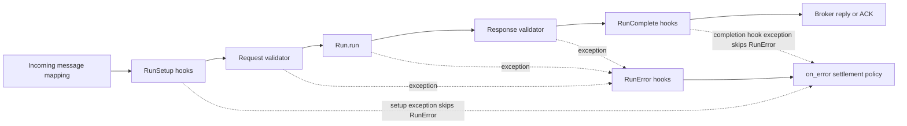

# Request/reply contracts and validation

[← Guide index](./README.en.md)

Describe and validate task input and output.

## Request/reply contracts and validation

`Descriptor` **describes data structure**; `Validator` **validates and transforms
actual values**. Connect both to `Specification` to document and validate tasks.
Place the following examples in the same file, in order.

### 1. Describe a schema with Descriptor

```python
from DefStream.Descriptor import DumpSchema, Integer, Object, Properties, Schema


request_schema = Object(
  description='Addition request',
  properties=Properties(
    a=Integer('First operand'),
    b=Integer('Second operand'),
  ),
)
response_schema = Integer('Sum')

print(DumpSchema(Schema(
  'AddRequest',
  request_schema,
)))
```

`Object` describes an object, `Properties` its fields, and `Integer` an integer.
Fields such as `Integer` are required by default; use `required=False` to mark
an optional field. Use `String`, `Number`, `Boolean`, and `Array` for other types
and nested structures. Wrap a value in `Schema` before passing it to
`DumpSchema()` to obtain a plain JSON Schema dictionary.

This documents `a` and `b` as required integers but **does not validate messages
automatically**. Required fields, defaults, and ranges need corresponding
validation rules if they must also be enforced at runtime.

### 2. Validate values with Validator

```python
from DefStream.Validator import Validator
from DefStream.Validator.Patterns import IsInteger, IsObject
from DefStream.Validator.Patterns.Object import IsMappingOf, IsRequiredIn


request_validator = Validator(
  IsObject(
    IsRequiredIn(
      'a',
      'b',
    ),
    IsMappingOf({
      'a': IsInteger(),
      'b': IsInteger(),
    }),
  ),
)
response_validator = Validator(IsInteger())

print(request_validator({'a': 10, 'b': 20}))
```

- `Validator` applies patterns in order and returns the final value.
- `IsObject` checks for the `dict` type, then runs its nested required-key and field-type rules.
- `IsRequiredIn` raises `ValueError` for missing keys; `IsInteger` raises `TypeError`
  for wrong types, including the string `'10'` and boolean `True`.
- `IsMappingOf` validates/transforms configured fields and may update the dictionary
  in place. Pass a copy to preserve the original. It does not remove or reject
  unconfigured extra keys. Extra keys that do not match task arguments make the
  call fail; implement additional restrictions if needed.

### 3. Combine conversion and validation

To accept numeric strings, use an explicit conversion pattern instead of
`IsInteger`. This independent example converts a string to an integer and then
checks that it is non-negative.

```python
from DefStream.Validator import Validator
from DefStream.Validator.Patterns import IsGreaterEqualTo, ToInteger


non_negative_integer = Validator(
  ToInteger(),
  IsGreaterEqualTo(0),
)

print(non_negative_integer('10'))
```

The result is integer `10`, not a string. Invalid strings and negative values
raise `ValueError`. `ToInteger` handles Python numeric-literal strings and
differs from strict type checking. This converter does not change the strict
request validator above. To apply it to a field, set that field's value in
`IsMappingOf` to `non_negative_integer`.

### 4. Connect task request and response contracts

Replace the earlier `Add` with the following class using the schemas and
validators defined above. Once registered with the Worker, inputs are validated
before `run()`, and the return value before completion hooks.

```python
from DefStream.Broker.Implements.RabbitMQ import Reject, Subscription
from DefStream.Worker import Run, Specification


class Add(
  Run,
  parameters=Subscription(queue='defstream.example.validated-add'),
  on_error=Reject(),
  request=Specification(
    schema=request_schema,
    validator=request_validator,
    example={'a': 10, 'b': 20},
  ),
  response=Specification(
    schema=response_schema,
    validator=response_validator,
    example=30,
  ),
  name='add',
  description='Add two integers',
):
  def run(
    self,
    a: int,
    b: int,
  ):
    return a + b
```

- `schema` is documentation metadata: it accepts JSON Schema mappings, Descriptor values/conditions,
  and dataclass types, but does not itself validate values or instantiate models.
- `validator` is a callable validation/transformation function. Its returned value is used for execution.
  A request validator must still return a mapping with string keys.
- Plain JSON Schema dictionaries and custom validation functions can also be passed as `schema` and `validator`.
- `example` is documentation data and is not automatically executed or validated.
- `format` defaults to `application/json`. It changes documented media types, not broker codecs.
- Run's `name` is used as both the AsyncAPI Operation key and the Metrics task key.
  When omitted, `module.__qualname__` is used; Run's `description` appears on the AsyncAPI Operation.
  Explicit names must match `[A-Za-z0-9_.-]+`; whitespace and Korean characters are not allowed.
  Names are case-sensitive and preserved exactly as provided.
- Execution order: setup hooks → request validation → `run()` → response validation → completion hooks → reply/ACK.



`RunSetup` runs before request validation; `RunError` applies to task and request/response validation errors. If a `RunComplete` hook itself fails, the message follows the failure-settlement path, but `RunError` is not called again. See the [Lifecycle hooks guide](./LifecycleHooks.en.md) for exception details.

Validation exceptions are task failures and follow error hooks and the `on_error`
policy. The example's `Reject()` avoids endlessly retrying invalid inputs.
To preserve failures in a DLQ, also configure `Subscription(error=...)` and
provision it through `declare()`. Schemas and examples appear in Inspector's
AsyncAPI and Play; custom Validator patterns are not automatically
reverse-engineered into JSON Schema.
