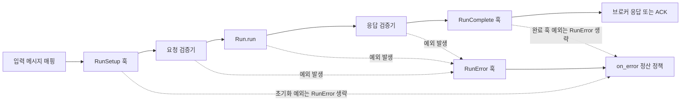

# 요청·응답 계약과 검증

[← 매뉴얼 목차](./README.md)

작업 데이터의 스키마와 검증기를 구성하는 방법입니다.

## 요청·응답 계약과 검증

`Descriptor`는 **데이터의 구조를 설명**하고, `Validator`는 **실제 값을 검증·변환**합니다.
두 도구를 `Specification`에 연결하면 작업의 문서와 실행 시 검증을 함께 구성할 수 있습니다.
다음 예제들은 위에서부터 같은 파일에 이어서 작성하세요.

### 1. Descriptor로 스키마 작성

```python
from DefStream.Descriptor import DumpSchema, Integer, Object, Properties, Schema


request_schema = Object(
  description='Addition request',
  properties=Properties(
    a=Integer('First operand'),
    b=Integer('Second operand'),
  ),
)
response_schema = Integer('Sum')

print(DumpSchema(Schema(
  'AddRequest',
  request_schema,
)))
```

`Object`는 객체, `Properties`는 필드, `Integer`는 정수를 설명합니다.
`Integer` 등의 필드는 기본적으로 필수이며 `required=False`로 선택 필드를 표시할 수 있습니다.
`String`, `Number`, `Boolean`, `Array` 등으로 다른 타입과 중첩 구조도 표현합니다.
`DumpSchema()`에는 `Schema`로 감싼 값을 전달하여 일반 JSON Schema 딕셔너리를 얻습니다.

이 스키마는 `a`, `b`를 정수 필수 필드로 문서화하지만 **메시지를 자동 검증하지는 않습니다.**
스키마의 필수 여부·기본값·범위를 실제 실행에서도 적용하려면 대응하는 검증 규칙이 필요합니다.

### 2. Validator로 값 검증

```python
from DefStream.Validator import Validator
from DefStream.Validator.Patterns import IsInteger, IsObject
from DefStream.Validator.Patterns.Object import IsMappingOf, IsRequiredIn


request_validator = Validator(
  IsObject(
    IsRequiredIn(
      'a',
      'b',
    ),
    IsMappingOf({
      'a': IsInteger(),
      'b': IsInteger(),
    }),
  ),
)
response_validator = Validator(IsInteger())

print(request_validator({'a': 10, 'b': 20}))
```

- `Validator`는 패턴을 지정한 순서대로 적용하고 마지막 값을 반환합니다.
- `IsObject`는 `dict` 타입을 확인하고, 내부 패턴으로 필수 키와 각 필드의 타입을 검사합니다.
- `IsRequiredIn`은 키 누락 시 `ValueError`, `IsInteger`는 잘못된 타입에 `TypeError`를 발생시킵니다.
  문자열 `'10'`이나 불리언 `True`를 정수로 인정하지 않습니다.
- `IsMappingOf`는 지정한 필드를 검증·변환하며 딕셔너리를 직접 갱신할 수 있습니다.
  원본 보존이 필요하면 복사본을 전달하세요. 지정하지 않은 추가 키를 제거하거나 거부하지는 않습니다.
  추가 키가 작업 함수의 인자와 맞지 않으면 호출이 실패하므로 필요한 제한을 별도로 작성하세요.

### 3. 검증과 변환 조합

숫자 문자열을 허용하려면 `IsInteger` 대신 명시적인 변환 패턴을 사용합니다.
아래는 문자열을 정수로 변환한 후 0 이상인지 검사하는 독립적인 예제입니다.

```python
from DefStream.Validator import Validator
from DefStream.Validator.Patterns import IsGreaterEqualTo, ToInteger


non_negative_integer = Validator(
  ToInteger(),
  IsGreaterEqualTo(0),
)

print(non_negative_integer('10'))
```

결과는 문자열이 아닌 정수 `10`입니다. 변환할 수 없는 문자열이나 음수는 `ValueError`가 발생합니다.
`ToInteger`는 Python 숫자 리터럴 형식의 문자열을 처리하며, 엄격한 타입 검사와 동작이 다릅니다.
이 변환기는 위의 엄격한 요청 검증기를 바꾸지 않습니다. 필드에 적용하려면
`IsMappingOf`의 해당 값에 `non_negative_integer`를 넣으세요.

### 4. 작업의 요청·응답에 연결

앞에서 만든 스키마와 검증기를 사용하여 기존 `Add`를 다음처럼 대체합니다.
이 클래스를 Worker에 등록하면 요청은 `run()` 전에, 반환값은 완료 훅 전에 검증합니다.

```python
from DefStream.Broker.Implements.RabbitMQ import Reject, Subscription
from DefStream.Worker import Run, Specification


class Add(
  Run,
  parameters=Subscription(queue='defstream.example.validated-add'),
  on_error=Reject(),
  request=Specification(
    schema=request_schema,
    validator=request_validator,
    example={'a': 10, 'b': 20},
  ),
  response=Specification(
    schema=response_schema,
    validator=response_validator,
    example=30,
  ),
  name='add',
  description='Add two integers',
):
  def run(
    self,
    a: int,
    b: int,
  ):
    return a + b
```

- `schema`는 문서용입니다. JSON Schema 매핑, Descriptor 값·조건, dataclass 타입 등을 받지만,
  그 자체로 런타임 검증이나 모델 생성을 수행하지 않습니다.
- `validator`는 호출 가능한 검증·변환 함수이며 반환한 값을 실제 실행에 사용합니다.
  요청 검증 결과도 문자열 키를 가진 매핑이어야 합니다.
- 일반 JSON Schema 딕셔너리와 직접 작성한 검증 함수도 각각 `schema`, `validator`에 전달할 수 있습니다.
- `example`은 문서용 값이며 자동 실행·검증하지 않습니다.
- `format`의 기본값은 `application/json`입니다. 문서의 미디어 타입만 바꾸며 브로커 코덱은 별도 설정입니다.
- Run의 `name`은 AsyncAPI Operation 키와 Metrics 작업 키에 함께 사용합니다.
  생략하면 `모듈명.__qualname__`을 사용하며, Run의 `description`은 AsyncAPI Operation에 표시됩니다.
  명시적 이름은 `[A-Za-z0-9_.-]+` 형식이며 공백·한국어는 허용하지 않습니다.
  대소문자와 입력값을 그대로 보존합니다.
- 실행 순서는 초기화 훅 → 요청 검증 → `run()` → 응답 검증 → 완료 훅 → 응답 발행·ACK입니다.

검증 예외는 작업 실패로 처리되어 오류 훅과 `on_error` 정책을 따릅니다.
예제의 `Reject()`는 잘못된 입력을 무한 재시도하지 않게 합니다. DLQ에 보관하려면
`Subscription(error=...)`도 지정하고 `declare()`로 해당 큐를 준비하세요.
스키마·예제는 Inspector의 AsyncAPI와 Play에 표시되며,
사용자 정의 Validator 패턴을 자동으로 JSON Schema로 역변환하지는 않습니다.



`RunSetup`은 요청 검증보다 먼저 호출되고 `RunError`는 작업·요청·응답 오류 경로에 적용됩니다. `RunComplete` 훅이 자체적으로 실패하면 메시지는 실패 정산 경로로 가지만 `RunError`가 다시 호출되지는 않습니다. 자세한 예외 범위는 [생명주기 훅 안내](./LifecycleHooks.md)를 참고하세요.
