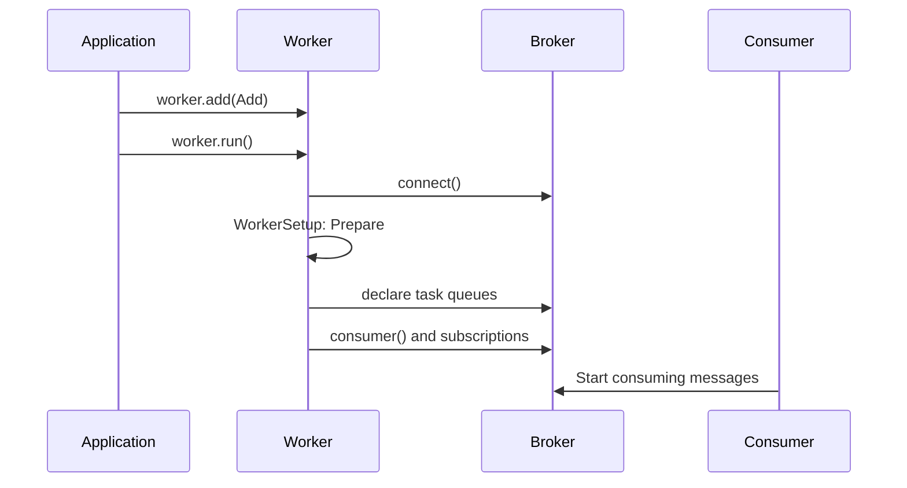

# Installation and quick start

[← Guide index](./README.en.md)

Install DefStream and run a first worker.

## Installation

Requires Python **3.9 or newer**. Prepare the broker server you intend to use.

```shell
python -m pip install "DefStream[RabbitMQ]"
```

Choose Redis or both adapters as needed:

```shell
python -m pip install "DefStream[Redis]"
python -m pip install "DefStream[RabbitMQ,Redis]"
```

For the core alone, use `python -m pip install DefStream`.
Both broker implementations are included in the DefStream distribution, but the default
installation has no broker client dependencies. The `RabbitMQ` extra installs `pika>=1.3.2`;
the `Redis` extra installs `redis>=5.1.1`.

| Installation choice | Python import path | Guide |
| --- | --- | --- |
| `DefStream` | `DefStream` | This document |
| `DefStream[RabbitMQ]` | `DefStream.Broker.Implements.RabbitMQ` | [RabbitMQ usage](./RabbitMQ.en.md#rabbitmq-usage) |
| `DefStream[Redis]` | `DefStream.Broker.Implements.Redis` | [Redis usage](./Redis.en.md#redis-usage) |

Separate releases of `DefStream-RabbitMQ` and `DefStream-Redis` are discontinued,
and their projects are scheduled for deletion. Backward compatibility with those
packages is not supported. Install the merged package in a new environment using
the commands above. To migrate an existing environment, first run
`python -m pip uninstall DefStream-RabbitMQ DefStream-Redis`, then reinstall the
merged DefStream. Do not install them together: they provide files at the same import paths.
For an existing environment, use
`python -m pip install --force-reinstall "DefStream[RabbitMQ,Redis]"`,
selecting extras for the brokers you actually use.


## Quick start

These examples assume a local RabbitMQ server at `127.0.0.1:5672`.
Save the following three files in the same directory. The `guest` credentials
are for local examples only; use a dedicated account and environment variables
or a secret store in production.

### 1. Define a task: `tasks.py`

```python
from DefStream.Broker.Implements.RabbitMQ import Reject, Subscription
from DefStream.Worker import Run


class Add(
  Run,
  parameters=Subscription(
    queue='defstream.example.add',
    qos=4,
    error='defstream.example.add.error',
  ),
  on_error=Reject(),
):
  def run(
    self,
    a: int,
    b: int,
  ):
    result = a + b
    print(result)
    return result
```

`parameters` selects the task's queue. A body of `{'a': 10, 'b': 20}` becomes
`run(a=10, b=20)`. This example rejects failures instead of retrying them and
declares an error queue to receive rejected messages.

### 2. Run the Worker: `worker.py`

`Worker` accepts `DefStream.Broker.Connection` directly.
The connection contract only requires `connect()` and `close()`. The worker checks
for `GetConsumer` support internally when it runs. A broker that cannot create
a consumer raises `TypeError`; no worker-specific connection type is needed.

```python
from signal import SIGINT, signal

from DefStream.Broker.Implements.RabbitMQ import Configuration, Connection
from DefStream.Worker import ThreadPool, Worker, WorkerSetup, declare
from tasks import Add


class Prepare(WorkerSetup):
  def __call__(
    self,
    worker: Worker,
  ) -> None:
    for task in worker.tasks:
      declare(
        task=task,
        broker=worker.broker,
      )


if __name__ == '__main__':
  worker = Worker(
    Connection(Configuration(
      host='127.0.0.1',
      port=5672,
      username='guest',
      password='guest',
    )),
    ThreadPool(4),
    setups=Prepare(),
  )
  worker.add(Add)
  signal(
    SIGINT,
    lambda *_: worker.stop(),
  )
  worker.run()
```

```shell
python worker.py
```

The Worker opens its broker connection, runs `Prepare` to declare the queue
and error queue, then starts consuming. Defining a `Run` does not register it:
call `worker.add()` explicitly.



### 3. Send messages: `client.py`

Run this in another terminal while the Worker is running.

```python
from DefStream.Broker.Implements.RabbitMQ import Configuration, Connection
from DefStream.Worker import emit, request
from tasks import Add


connection = Connection(Configuration(
  host='127.0.0.1',
  port=5672,
  username='guest',
  password='guest',
))
try:
  connection.connect()
  message_id = emit(
    {'a': 10, 'b': 20},
    task=Add,
    broker=connection,
  )
  print(message_id)
  result = request(
    {'a': 10, 'b': 20},
    task=Add,
    broker=connection,
    timeout=5,
  )
  print(result)
finally:
  connection.close()
```

```shell
python client.py
```

`emit()` and `request()` **each publish a separate task**. This example performs
the addition twice; `request()` returns `30`. The request timeout is in seconds
and does not cancel work that has already been delivered.
