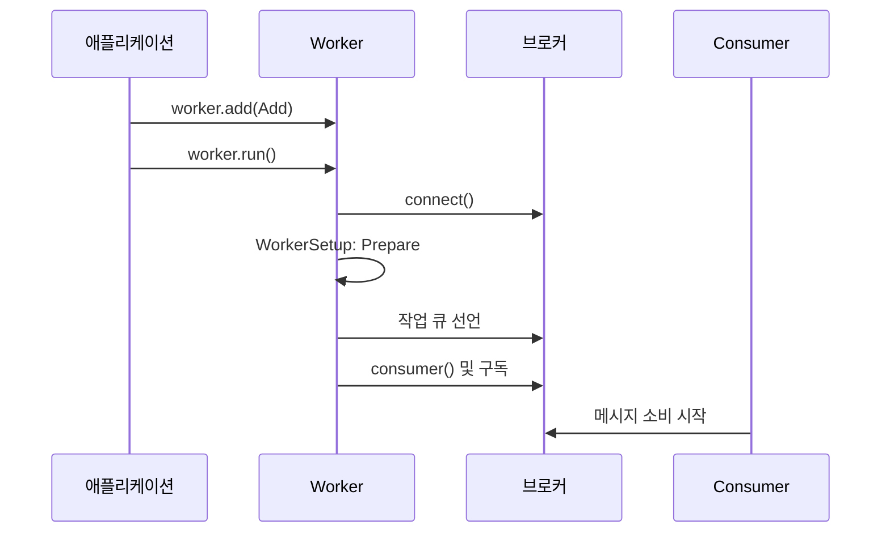

# 설치와 빠른 시작

[← 매뉴얼 목차](./README.md)

설치와 첫 작업을 실행하는 기본 절차입니다.

## 설치

Python **3.9 이상**이 필요합니다. 실제 메시지 처리를 위해 사용할 브로커 서버도 준비하세요.

```shell
python -m pip install "DefStream[RabbitMQ]"
```

Redis를 사용하거나 두 어댑터를 모두 설치하려면 다음과 같이 선택합니다.

```shell
python -m pip install "DefStream[Redis]"
python -m pip install "DefStream[RabbitMQ,Redis]"
```

코어만 필요하면 `python -m pip install DefStream`을 사용합니다.
두 브로커 구현체는 모두 DefStream 배포본에 포함되지만, 기본 설치에는 브로커 클라이언트가 포함되지 않습니다.
`RabbitMQ` extra는 `pika>=1.3.2`, `Redis` extra는 `redis>=5.1.1`을 설치합니다.

| 선택 설치 | Python import 경로 | 사용 안내 |
| --- | --- | --- |
| `DefStream` | `DefStream` | 이 문서 |
| `DefStream[RabbitMQ]` | `DefStream.Broker.Implements.RabbitMQ` | [RabbitMQ 사용 방법](./RabbitMQ.md#rabbitmq-사용-방법) |
| `DefStream[Redis]` | `DefStream.Broker.Implements.Redis` | [Redis 사용 방법](./Redis.md#redis-사용-방법) |

기존 `DefStream-RabbitMQ`와 `DefStream-Redis` 패키지의 별도 배포는 종료하며,
기존 프로젝트는 삭제 예정입니다. 기존 패키지와의 하위 호환성은 지원하지 않습니다.
새 환경에 위 명령으로 통합 패키지를 설치하세요. 기존 환경을 전환한다면 먼저
`python -m pip uninstall DefStream-RabbitMQ DefStream-Redis`로 별도 어댑터를 제거한 후
통합된 DefStream을 다시 설치하세요. 같은 import 경로의 파일을 제공하므로 함께 설치하지 마세요.
기존 환경에서 재설치할 때는 `python -m pip install --force-reinstall "DefStream[RabbitMQ,Redis]"`를
사용하고, 실제 사용하는 브로커에 맞게 extra를 선택하세요.


## 빠르게 시작하기

로컬 RabbitMQ가 `127.0.0.1:5672`에서 실행 중이라고 가정합니다.
아래 세 파일을 같은 디렉터리에 저장하세요. `guest` 계정은 로컬 실행 예제이며,
운영에서는 별도 계정과 환경변수·비밀 저장소를 사용하세요.

### 1. 작업 정의: `tasks.py`

```python
from DefStream.Broker.Implements.RabbitMQ import Reject, Subscription
from DefStream.Worker import Run


class Add(
  Run,
  parameters=Subscription(
    queue='defstream.example.add',
    qos=4,
    error='defstream.example.add.error',
  ),
  on_error=Reject(),
):
  def run(
    self,
    a: int,
    b: int,
  ):
    result = a + b
    print(result)
    return result
```

`parameters`는 작업이 소비할 큐를 지정합니다. 메시지 본문 `{'a': 10, 'b': 20}`은
`run(a=10, b=20)`으로 전달됩니다. 이 예제는 실패 시 재시도 대신 거부하며,
거부된 메시지를 받을 오류 큐도 선언합니다.

### 2. Worker 실행: `worker.py`

`Worker`는 `DefStream.Broker.Connection`을 직접 받습니다.
연결 계약은 `connect()`, `close()`만 요구하며, 워커 실행 시 내부에서
`GetConsumer` 지원 여부를 검사합니다. 컨슈머를 생성할 수 없는 브로커는 `TypeError`를 발생시키며,
워커 전용 연결 타입은 필요하지 않습니다.

```python
from signal import SIGINT, signal

from DefStream.Broker.Implements.RabbitMQ import Configuration, Connection
from DefStream.Worker import ThreadPool, Worker, WorkerSetup, declare
from tasks import Add


class Prepare(WorkerSetup):
  def __call__(
    self,
    worker: Worker,
  ) -> None:
    for task in worker.tasks:
      declare(
        task=task,
        broker=worker.broker,
      )


if __name__ == '__main__':
  worker = Worker(
    Connection(Configuration(
      host='127.0.0.1',
      port=5672,
      username='guest',
      password='guest',
    )),
    ThreadPool(4),
    setups=Prepare(),
  )
  worker.add(Add)
  signal(
    SIGINT,
    lambda *_: worker.stop(),
  )
  worker.run()
```

```shell
python worker.py
```

Worker가 브로커 연결을 열고, `Prepare`가 큐와 오류 큐를 선언한 뒤 구독을 시작합니다.
`Run`을 정의하는 것만으로 등록되지는 않으며 `worker.add()`가 필요합니다.



### 3. 메시지 보내기: `client.py`

Worker가 실행 중인 상태에서 다른 터미널에서 실행하세요.

```python
from DefStream.Broker.Implements.RabbitMQ import Configuration, Connection
from DefStream.Worker import emit, request
from tasks import Add


connection = Connection(Configuration(
  host='127.0.0.1',
  port=5672,
  username='guest',
  password='guest',
))
try:
  connection.connect()
  message_id = emit(
    {'a': 10, 'b': 20},
    task=Add,
    broker=connection,
  )
  print(message_id)
  result = request(
    {'a': 10, 'b': 20},
    task=Add,
    broker=connection,
    timeout=5,
  )
  print(result)
finally:
  connection.close()
```

```shell
python client.py
```

`emit()`와 `request()`는 **각각 별도의 작업을 발행**합니다. 위 예제는 덧셈을 두 번 실행하며,
`request()`의 결과는 `30`입니다. `request()`의 제한 시간은 초 단위이고,
시간이 초과되어도 이미 전달된 작업은 취소되지 않습니다.
