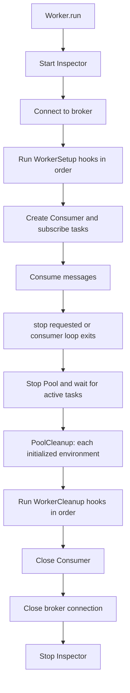
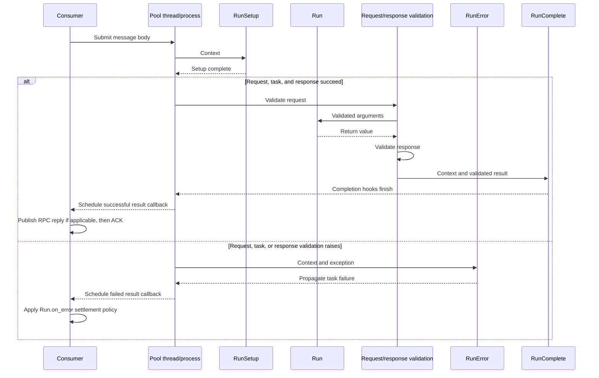

# Lifecycle hooks

[← Guide index](./README.en.md)

DefStream hooks provide initialization, completion, error observation, and cleanup at three scopes: individual task executions, each execution-pool thread or process, and the Worker. This guide covers their locations, order, failure behavior, and resource ownership.

## Hook types and contracts

All hook interfaces are available from `DefStream.Worker`. Each hook option accepts one callable or an ordered sequence of callables.

| Scope | Hook | Invocation | Arguments |
| --- | --- | --- | --- |
| Task | `RunSetup` | Before each task execution and before request validation | `Context` |
| Task | `RunComplete` | After successful task execution and response validation | `Context`, result |
| Task | `RunError` | When `run()` or request/response validation raises an exception | `Context`, exception |
| Pool | `PoolSetup` | When each execution thread/process becomes ready | None |
| Pool | `PoolCleanup` | When each successfully initialized execution environment exits | None |
| Worker | `WorkerSetup` | After broker connection, before consumer creation/subscription | `Worker` |
| Worker | `WorkerCleanup` | After pool shutdown, before consumer/broker connection closure | `Worker` |

Set task hooks on the `Run` class with `setups=`, `completes=`, and `errors=`. Pool constructors accept `setups=` and `cleanups=`; the Worker constructor uses the same option names.

RabbitMQ consumption recovery preserves the Pool object and replaces its internal executor. `PoolSetup` runs again when a new execution unit starts. A retired ThreadPool runs `PoolCleanup` after its running task finishes; forcibly terminated ProcessPool processes do not guarantee task/pool cleanup. `WorkerSetup` runs only at initial startup and `WorkerCleanup` only at final shutdown, not on each recovery. See [consumption recovery](./RabbitMQ.en.md#worker-consumption-recovery) for limitations.

```python
from signal import SIGINT, signal

from DefStream.Broker.Implements.RabbitMQ import (
  Configuration,
  Connection,
  Reject,
  Subscription,
)
from DefStream.Worker import (
  Context,
  PoolCleanup,
  PoolSetup,
  Run,
  RunComplete,
  RunError,
  RunSetup,
  ThreadPool,
  Worker,
  WorkerCleanup,
  WorkerSetup,
  declare,
)


class TraceRunSetup(RunSetup):
  def __call__(self, context: Context) -> None:
    print('starting task with keys:', tuple(context.kwargs))


class TraceRunComplete(RunComplete):
  def __call__(self, context: Context, completion: object) -> None:
    print('completed result type:', type(completion).__name__)


class TraceRunError(RunError):
  def __call__(self, context: Context, error: Exception) -> None:
    print('failed with:', type(error).__name__)


class OpenPoolResource(PoolSetup):
  def __call__(self) -> None:
    print('initialize this execution environment')


class ClosePoolResource(PoolCleanup):
  def __call__(self) -> None:
    print('release this execution environment')


class PrepareWorker(WorkerSetup):
  def __call__(self, worker: Worker) -> None:
    for task in worker.tasks:
      declare(task=task, broker=worker.broker)


class ReleaseWorker(WorkerCleanup):
  def __call__(self, worker: Worker) -> None:
    print('release Worker resources')


class Add(
  Run,
  parameters=Subscription(queue='defstream.example.lifecycle'),
  on_error=Reject(),
  setups=TraceRunSetup(),
  completes=TraceRunComplete(),
  errors=TraceRunError(),
):
  def run(self, a: int, b: int) -> int:
    return a + b


if __name__ == '__main__':
  worker = Worker(
    Connection(Configuration(
      host='127.0.0.1',
      port=5672,
      username='guest',
      password='guest',
    )),
    ThreadPool(
      4,
      setups=OpenPoolResource(),
      cleanups=ClosePoolResource(),
    ),
    setups=PrepareWorker(),
    cleanups=ReleaseWorker(),
  )
  worker.add(Add)
  signal(SIGINT, lambda *_: worker.stop())
  worker.run()
```

This example assumes a local RabbitMQ server at `127.0.0.1:5672`. The `guest`
credentials are for local examples only; use a dedicated account and secret
store in production. The example demonstrates hook invocation points. If hooks
manage a database or external resource, track successful initialization and
make cleanup safe after partial initialization.

## Execution order

### Worker startup and shutdown

The Worker starts the Inspector, connects to the broker, runs Worker setup hooks, then creates the consumer and subscribes. After `stop()` is requested, it stops receiving new deliveries and waits for active work and message settlement before cleaning up resources in this order:



Worker setup hooks run after the connection is open, so they can use `worker.broker` and the registered `worker.tasks`. The Consumer has not been created yet. For example, a `WorkerSetup` can call `declare()` to prepare queues and related resources.

If Worker setup or consumption raises, the `finally` path still attempts to stop the pool and run Worker cleanup. `WorkerCleanup` must account for partially completed initialization. If a cleanup hook raises, remaining Worker cleanup hooks and Consumer, broker, and Inspector closure are still attempted, but the cleanup exception propagates to the caller.

`worker.stop()` requests graceful shutdown and waits for active tasks and settlement. Forced termination and a shutdown timeout are not currently provided. Hooks are not guaranteed to run after forced termination, a crash, or power loss.

### Processing one task



An exception from `RunSetup` bypasses `RunError` and reaches the failure callback. An exception from `RunComplete` also reaches the failure callback without invoking `RunError` again. Message completion runs on the Consumer-owning thread. On success, RabbitMQ may publish an RPC response and then ACK the message. On failure, the task's `on_error` policy is applied. Redis does not support RPC replies.

### Execution-pool hooks

`ThreadPool` and `ProcessPool` execution environments start lazily when tasks are submitted. Each thread or process invokes its `PoolSetup` hooks in order, processes multiple tasks, and invokes its `PoolCleanup` hooks when it exits. These hooks do not run once per task.

If any `PoolSetup` hook fails, the environment never reaches the ready state, so its `PoolCleanup` hooks are not called. A successfully initialized environment runs cleanup hooks during normal pool shutdown. `run_cleanups` continues through remaining cleanup hooks after a failure, then propagates the failure.

## Context and task-hook behavior

`Context.args` and `Context.kwargs` contain the task call arguments. If the task has a request `Specification`, its validated/transformed mapping replaces `context.kwargs` before being passed to `run()`. If validation fails earlier, the original arguments may remain; do not assume error hooks always receive normalized input.

- `RunSetup` runs for every task execution, before request validation.
- `RunError` observes exceptions from `run()` and request/response validation. It does not handle every `BaseException`.
- `RunComplete` runs after `run()` and response validation succeed. If it raises, the Worker treats the message as failed, but `RunError` is not run again for that exception.
- A `RunSetup` exception occurs outside the task execution `try` block and is not passed to `RunError`.
- Hooks in a sequence run in the declared order. Exceptions are not silently ignored and can stop later hooks in the same phase.

`RunError` is application error-observation/handling code; `Run.on_error` is the message-settlement policy. Running an error hook alone does not turn failure into success. If `on_error` is omitted, the broker's default redelivery policy may apply.

## Resource ownership and thread/process considerations

| Resource | Suitable scope | Considerations |
| --- | --- | --- |
| Per-task temporary state | `RunSetup` and task body | Create per invocation and do not retain it after the task |
| Per-thread/process connection or client | `PoolSetup` / `PoolCleanup` | Keep it owned by that environment; do not share across threads/processes |
| Worker-wide declarations or prepared resources | `WorkerSetup` / `WorkerCleanup` | Prepare before Consumer creation; clean up after the pool stops |

`ProcessPool` may use spawned processes. Define pool hooks at importable module scope and do not assume process-shared state. Synchronize shared state used by `ThreadPool` hooks.

The Worker's broker connection is used by the thread that owns the Consumer. If a task or hook must publish a message, do not share the Worker's broker connection with the pool; create and close an independent connection in the task or hook's execution environment. If a `RunComplete` hook publishes a message and then fails, the publication is not rolled back.

For shutdown and pool behavior, see [Task processing and execution](./Tasks.en.md#execution-pools-and-shutdown). For broker-specific settlement behavior, see [RabbitMQ](./RabbitMQ.en.md) and [Redis](./Redis.en.md).
