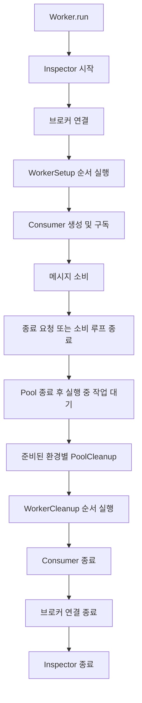
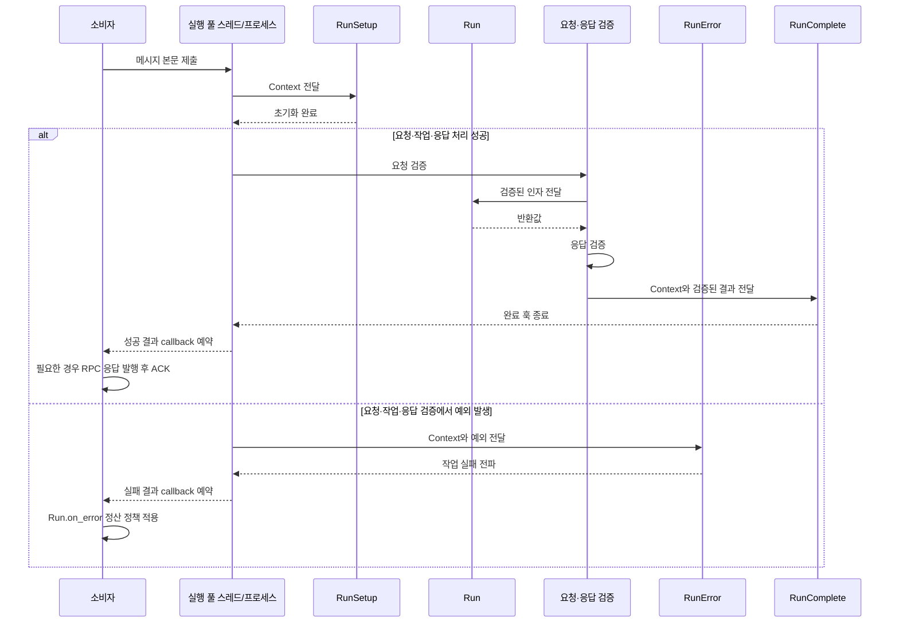

# 생명주기 훅

[← 매뉴얼 목차](./README.md)

DefStream의 훅은 작업, 실행 풀의 각 스레드·프로세스, Worker의 세 범위에서 초기화·완료·오류·정리를 수행합니다. 이 문서는 각 훅이 실행되는 위치와 순서, 실패 처리와 자원 관리 기준을 설명합니다.

## 훅의 종류와 계약

모든 훅은 `DefStream.Worker`에서 가져올 수 있습니다. 각 훅 옵션에는 단일 호출 가능 객체 또는 순서가 있는 시퀀스를 전달할 수 있습니다.

| 범위 | 훅 | 호출 시점 | 전달 인자 |
| --- | --- | --- | --- |
| 작업 | `RunSetup` | 매 작업 실행 전, 요청 검증 전 | `Context` |
| 작업 | `RunComplete` | 작업 및 응답 검증 성공 후 | `Context`, 결과 |
| 작업 | `RunError` | `run()` 또는 요청·응답 검증에서 예외 발생 시 | `Context`, 예외 |
| 풀 | `PoolSetup` | 각 실행 스레드·프로세스가 준비될 때 | 없음 |
| 풀 | `PoolCleanup` | 준비에 성공한 각 실행 환경이 종료될 때 | 없음 |
| Worker | `WorkerSetup` | 브로커 연결 후, 소비자 생성·구독 전 | `Worker` |
| Worker | `WorkerCleanup` | 풀 종료 후, 소비자·브로커 연결 종료 전 | `Worker` |

작업 훅은 `Run` 클래스 정의에 `setups=`, `completes=`, `errors=`로 지정합니다. 풀 생성자는 `setups=`, `cleanups=`를 받고, Worker 생성자도 같은 옵션 이름을 사용합니다.

```python
from signal import SIGINT, signal

from DefStream.Broker.Implements.RabbitMQ import (
  Configuration,
  Connection,
  Reject,
  Subscription,
)
from DefStream.Worker import (
  Context,
  PoolCleanup,
  PoolSetup,
  Run,
  RunComplete,
  RunError,
  RunSetup,
  ThreadPool,
  Worker,
  WorkerCleanup,
  WorkerSetup,
  declare,
)


class TraceRunSetup(RunSetup):
  def __call__(self, context: Context) -> None:
    print('starting task with keys:', tuple(context.kwargs))


class TraceRunComplete(RunComplete):
  def __call__(self, context: Context, completion: object) -> None:
    print('completed result type:', type(completion).__name__)


class TraceRunError(RunError):
  def __call__(self, context: Context, error: Exception) -> None:
    print('failed with:', type(error).__name__)


class OpenPoolResource(PoolSetup):
  def __call__(self) -> None:
    print('initialize this execution environment')


class ClosePoolResource(PoolCleanup):
  def __call__(self) -> None:
    print('release this execution environment')


class PrepareWorker(WorkerSetup):
  def __call__(self, worker: Worker) -> None:
    for task in worker.tasks:
      declare(task=task, broker=worker.broker)


class ReleaseWorker(WorkerCleanup):
  def __call__(self, worker: Worker) -> None:
    print('release Worker resources')


class Add(
  Run,
  parameters=Subscription(queue='defstream.example.lifecycle'),
  on_error=Reject(),
  setups=TraceRunSetup(),
  completes=TraceRunComplete(),
  errors=TraceRunError(),
):
  def run(self, a: int, b: int) -> int:
    return a + b


if __name__ == '__main__':
  worker = Worker(
    Connection(Configuration(
      host='127.0.0.1',
      port=5672,
      username='guest',
      password='guest',
    )),
    ThreadPool(
      4,
      setups=OpenPoolResource(),
      cleanups=ClosePoolResource(),
    ),
    setups=PrepareWorker(),
    cleanups=ReleaseWorker(),
  )
  worker.add(Add)
  signal(SIGINT, lambda *_: worker.stop())
  worker.run()
```

로컬 RabbitMQ가 `127.0.0.1:5672`에서 실행 중이라고 가정합니다. `guest` 인증 정보는 로컬 예제 전용이며 운영에서는 별도 계정과 비밀 저장소를 사용하세요. 이 예제는 훅 호출 지점을 확인하기 위한 것입니다. 실제 데이터베이스나 외부 자원을 사용한다면 초기화 성공 여부를 추적하고, 부분 초기화 후에도 안전하게 정리되도록 훅을 구현하세요.

## 실행 순서

### Worker 시작과 종료

Worker는 Inspector 시작, 브로커 연결, Worker 초기화, 소비자 생성 및 구독 순서로 시작합니다. `stop()` 요청 후에는 새 전달을 중단하고 처리 중 작업과 메시지 정산을 기다린 뒤 다음 순서로 자원을 정리합니다.



Worker 초기화 훅은 연결을 연 뒤 실행되므로 `worker.broker`와 등록된 `worker.tasks`를 사용할 수 있습니다. 이때 Consumer는 아직 생성되지 않았습니다. 예를 들어 `WorkerSetup`에서 `declare()`를 호출해 큐와 관련 리소스를 준비할 수 있습니다.

Worker 초기화 또는 소비 중 예외가 발생해도 `finally` 경로에서 풀 종료와 Worker 정리를 시도합니다. `WorkerCleanup`은 Worker 초기화가 일부만 완료되었을 가능성을 고려해야 합니다. 정리 훅에서 예외가 나도 나머지 Worker 정리 훅과 Consumer·브로커·Inspector 종료를 시도하지만, 정리 예외는 호출자에게 전파됩니다.

`worker.stop()`은 정상 종료 요청이며, 현재 실행 중 작업이 끝나고 정산될 때까지 기다립니다. 강제 종료나 종료 시간 제한은 제공되지 않습니다. 프로세스 강제 종료·충돌·전원 손실 때는 훅이 실행된다고 보장할 수 없습니다.

### 한 작업의 처리



`RunSetup` 예외는 `RunError`를 거치지 않고 실패 callback으로 전달됩니다. `RunComplete` 예외도 `RunError`를 다시 거치지 않고 실패 callback으로 전달됩니다. 실제 메시지 완료 처리는 Consumer 소유 스레드에서 수행됩니다. 성공한 경우 RabbitMQ의 RPC 응답을 발행할 수 있으며 메시지를 ACK합니다. 실패한 경우 작업의 `on_error` 정책을 적용합니다. Redis는 RPC 응답을 지원하지 않습니다.

### 실행 풀 훅

`ThreadPool`과 `ProcessPool`의 실행 환경은 작업 제출에 따라 지연 시작됩니다. 각 스레드 또는 프로세스는 `PoolSetup` 시퀀스를 순서대로 호출한 뒤 여러 작업을 처리하고, 종료 시 `PoolCleanup` 시퀀스를 호출합니다. 작업마다 한 번 실행되는 것은 아닙니다.

`PoolSetup` 중 하나라도 실패하면 해당 실행 환경은 준비 완료 상태가 아니므로 그 환경의 `PoolCleanup`은 호출되지 않습니다. 준비가 성공한 환경은 정상 풀 종료에서 정리 훅이 호출됩니다. `run_cleanups`는 한 정리 훅이 실패해도 남은 훅을 실행한 다음 실패를 전파합니다.

## 컨텍스트와 작업 훅

`Context.args`와 `Context.kwargs`는 작업 호출 인자를 담습니다. 요청 `Specification`이 있으면 검증·변환된 매핑이 `context.kwargs`에 반영된 뒤 `run()`에 전달됩니다. 검증 전 단계에서 실패하면 최초 인자 형태가 남을 수 있으므로 오류 훅은 입력이 항상 정규화되어 있다고 가정하지 마세요.

- `RunSetup`은 각 작업 실행마다 호출되며 요청 검증보다 먼저 실행됩니다.
- `RunError`는 `run()` 실행과 요청·응답 검증에서 발생한 `Exception`을 관찰합니다. `BaseException` 전체를 처리하는 훅은 아닙니다.
- `RunComplete`는 `run()`과 응답 검증이 성공한 뒤 호출됩니다. 훅이 예외를 발생시키면 메시지는 Worker에서 실패로 처리되지만, 그 예외에 대해 `RunError`가 다시 실행되지는 않습니다.
- `RunSetup` 예외는 작업 실행의 `try` 블록 바깥에서 발생하므로 `RunError`에 전달되지 않습니다.
- 훅 시퀀스는 지정한 순서로 실행합니다. 훅 내부 예외는 조용히 무시되지 않으며, 뒤에 있는 같은 단계의 작업 훅 실행을 중단할 수 있습니다.

`RunError`는 오류 관찰·처리 코드이고 `Run.on_error`는 메시지 정산 정책입니다. 오류 훅의 실행만으로 실패가 성공으로 바뀌지 않습니다. `on_error`를 생략하면 브로커의 기본 재전달 정책이 사용될 수 있습니다.

## 자원 소유 및 스레드·프로세스 고려사항

| 자원 유형 | 적절한 범위 | 고려사항 |
| --- | --- | --- |
| 작업별 임시 상태 | `RunSetup` 및 작업 본문 | 호출마다 생성하고 작업 종료 후 참조를 유지하지 않음 |
| 스레드·프로세스별 연결·클라이언트 | `PoolSetup` / `PoolCleanup` | 실행 환경 소유로 관리하고 다른 스레드·프로세스와 공유하지 않음 |
| Worker 전체의 선언·준비 자원 | `WorkerSetup` / `WorkerCleanup` | Consumer 생성 전 준비, 풀 종료 후 정리 |

`ProcessPool`은 `spawn` 기반 프로세스를 사용할 수 있습니다. 풀 훅은 모듈 최상위에서 import 가능한 객체로 정의하고, 프로세스 간 공유 상태가 있다고 가정하지 마세요. ThreadPool 훅에서 공유하는 상태는 동기화해야 합니다.

Worker의 브로커 연결은 Consumer를 소유하는 스레드에서 사용합니다. 풀 안에서 메시지를 발행해야 한다면 브로커 연결을 Worker에서 가져와 공유하지 말고, 훅 또는 작업이 실행되는 환경에서 독립 연결을 생성·종료하세요. `RunComplete`가 메시지를 이미 발행한 뒤 훅이 실패해도 발행 결과는 롤백되지 않습니다.

자세한 종료 및 풀 동작은 [작업 처리와 실행](./Tasks.md#실행-풀과-종료)을, 브로커별 정산 동작은 [RabbitMQ](./RabbitMQ.md)와 [Redis](./Redis.md)를 참고하세요.
