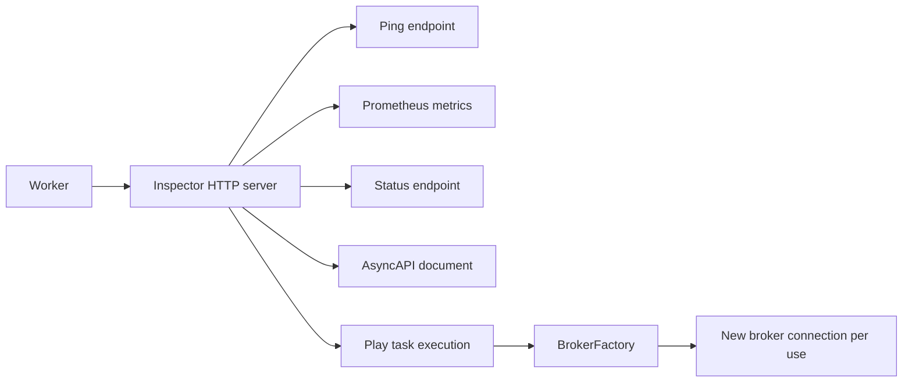

# Operations and monitoring

[← Guide index](./README.en.md)

Inspector tools, logging, and broker selection.

During RabbitMQ consumption recovery, the Worker clears its readiness state: Ping returns 503 until all subscriptions are restored and the consumption loop resumes. Unfinished Inspector contexts from the previous generation are closed as discarded, and old callbacks cannot change the new generation's metrics. See [RabbitMQ consumption recovery](./RabbitMQ.en.md#worker-consumption-recovery) for settings, retired-thread behavior, and redelivery limitations.

## Health checks and Play

Inspector is optional and uses a Python standard-library HTTP server.
Configure it before starting the Worker and pass `Worker(..., inspector=inspector)`.
This snippet reuses the `Connection` and `Configuration` imports from `worker.py`.

```python
from DefStream.Inspector import Inspector
from DefStream.Inspector.Extensions import (
  Play,
  Metrics,
  Ping,
  Specifications,
  Status,
)


def create_connection():
  return Connection(Configuration(
    host='127.0.0.1',
    port=5672,
    username='guest',
    password='guest',
  ))


inspector = Inspector(
  host='127.0.0.1',
  port=9999,
  exts=(
    Ping('/ping'),
    Metrics('/metrics'),
    Status('/status'),
    Specifications('/asyncapi.json'),
    Play(
      '/play',
      broker=create_connection,
      title='DefStream',
    ),
  ),
)
```

| Path | Purpose |
| --- | --- |
| `/ping` | Check subscription readiness and consumer-loop responsiveness: 200 when healthy, 503 during startup/shutdown or when unresponsive |
| `/metrics` | Prometheus metrics with the `defstream_` prefix |
| `/status` | Successes, failures, throughput, and duration; register with exactly one `Metrics` |
| `/asyncapi.json` | Registered task request/reply contracts as AsyncAPI JSON |
| `/play` | Browse tasks and schemas, send JSON messages, and execute RPC on supported brokers |

There are no default routes. Metrics describe one Worker and reset on restart.
Execution counts include retries and hooks, not unique messages or ACKs.
The dashboard provides recent 1-second and 60-second windows, not long-term storage.
Declaring a response contract does not add RPC support to Redis.



The `Console` extension has been renamed to `Play`. Update existing imports and
class usages to `Play`. The example above uses `/play`, but you can keep your
configured URL path. The extension logger is now `Worker.Inspector.Play`.

**Restrict access.** The Play example above publishes real tasks without
authentication. For authentication, pass a random token of at least 16 characters
using `Play(token=...)` and enter it in the browser. Load the token from an
environment variable or secret store. Other built-in endpoints remain
unauthenticated: bind to loopback or a trusted management network, and use an
HTTPS reverse proxy with additional access control for remote access.
Inspector has no built-in TLS and is not a public web server.
Play's connection factory must return a new connection on every call,
never the Worker's connection.

Play's `broker` parameter uses the `DefStream.Broker.BrokerFactory` contract.
Its `__call__() -> Connection` takes no arguments and returns a new connection.
Functions such as `create_connection` above and lambdas remain valid without changes.
For a class-based factory, you can inherit `BrokerFactory` and implement `__call__`.


## Logging

DefStream records messages through standard `logging` without configuring handlers,
formatters, or levels. Select the sources your application needs. The samples
output only the `Sample`, `Worker`, `Task`, and `Broker` logger hierarchies, replacing their
`print()` calls with logging. The Worker's existing startup banner is still
printed regardless of logging configuration.

```python
from logging import DEBUG, Filter, Formatter, StreamHandler, getLogger

sources = (
  Filter('Sample'),
  Filter('Worker'),
  Filter('Task'),
  Filter('Broker'),
)
handler = StreamHandler()
handler.setFormatter(Formatter(
  '%(asctime)s %(processName)s %(name)s %(levelname)s %(message)s'
))
handler.addFilter(lambda record: any(source.filter(record) for source in sources))
root = getLogger()
root.setLevel(DEBUG)
root.addHandler(handler)

logger = getLogger('Sample')
logger.info('Application started')
```

Apply filters to the **handler**, not the root logger. `Filter('Worker')`
includes `Worker` and names below `Worker.`, but not `WorkerExtra`.
Broker loggers use the separate `Broker` hierarchy and are not included by a
`Worker` filter.
This configuration is an example for a standalone application; it does not change
output from other handlers already installed. To receive only broker logs, select
`Broker.RabbitMQ` or `Broker.Redis`.

- The `Worker` and `Run` loggers use `Worker` and `Task`, respectively.
  `Executor`, `Pool`, `ThreadPool`, and `ProcessPool` use the `Worker` hierarchy.
- Shared Pool methods also use the concrete pool's logger member. User subclasses
  inherit the default name and can explicitly override `logger`.
- Inspector, Server, and RequestHandler share `Worker.Inspector`.
  HTTP request receipt is DEBUG; response status and transmission results are INFO.
  Extension-specific logs use `Worker.Inspector.<extension name>`.
- Normal per-message processing is DEBUG, lifecycle events are INFO, events
  requiring attention are WARNING, and processing failures are ERROR.
  Bodies, results, and credentials are excluded from the default log context.
- RabbitMQ and Redis broker loggers use the `Broker.RabbitMQ` and `Broker.Redis`
  hierarchies. Update filters and handlers that use the former `DefStream.Broker...` names.
- Worker logs use the `Worker` and `Task` hierarchies, while Inspector logs use
  `Worker.Inspector`. Update filters and handlers configured with former `DefStream.*` names.
- Without any handlers, Python's `lastResort` may write WARNING and higher to
  stderr. Do not put sensitive values in user exception messages: failure
  tracebacks include those messages.

ProcessPool uses `spawn` child processes, so parent handlers are not automatically
inherited. To receive child logs, apply the same configuration in an importable
`PoolSetup` implementation and pass it through `ProcessPool(..., setups=...)`.
That configuration cannot capture DEBUG and INFO logs emitted before the child
setup hook runs. See
[LoggingSetup in the RabbitMQ task example](../samples/Worker/RabbitMQ/Tasks.py)
and the [parent/child configuration example](../samples/Worker/RabbitMQ/Worker.py).
In existing applications, choose the initialization location carefully to avoid
adding the same handlers repeatedly.


## Broker selection and operational considerations

| Feature | RabbitMQ | Redis Streams |
| --- | --- | --- |
| Queue messaging | Supported | Streams and consumer groups |
| Exchange routing | Supported | Not supported |
| Stream history reads | Supported | Supported |
| Task RPC | Supported | Not supported |
| Error destination | Explicitly declared DLQ | No built-in destination |

- Use RabbitMQ connections/resources only on their owning thread, not from task threads sharing the consumer connection.
- Redis requires **6.2 or newer**. Consumers in one group share deliveries; different groups each receive the stream.
- Redis requeue appends a copy and ACKs the original, making the new message visible to other groups too.
- Redis reclaims pending entries after 60 seconds of idle time by default. Another consumer may reclaim an active long task.
  Direct consumer users can adjust `reclaim_idle` or disable it with `None`; the default Worker uses the default setting.
- Redis ACK/rejection preserves history. Manage retention externally and avoid removing pending entries.
- Do not assume automatic network reconnection or exactly-once execution.
  Design application restart, idempotency, retry, and error-queue policies.


## Examples and license

- [Worker without an external broker](../samples/Worker/Sample.py)
- [RabbitMQ Worker and RPC client](../samples/Worker/RabbitMQ)
- [Redis Worker](../samples/Worker/Redis/Sample.py)
- [Releases and change history](https://github.com/yong5eon/DefStream/releases)

Licensed under GNU GPL v3. See [LICENSE](../LICENSE) for the terms.
