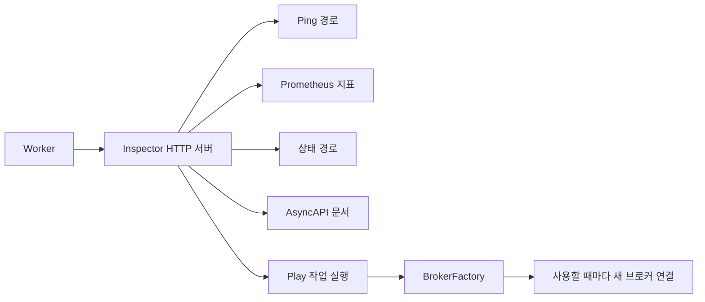

# 운영과 모니터링

[← 매뉴얼 목차](./README.md)

Inspector, 로깅 및 브로커 선택 시 고려사항입니다.

RabbitMQ Worker는 소비 장애 복구 중 준비 상태를 해제하므로 Ping은 503을 반환하고, 전체 구독 복원 후 소비 루프를 다시 시작하면 준비 상태를 복원합니다. 이전 실행 세대의 미완료 Inspector context는 폐기 상태로 마무리하고, 이전 콜백이 새 실행 세대의 지표를 변경하지 못하게 합니다. 복구 설정과 잔존 스레드·메시지 재전달의 제한은 [RabbitMQ 소비 장애 복구](./RabbitMQ.md#worker-소비-장애-복구)를 참고하세요.

## 상태 확인과 Play

선택 기능인 Inspector는 Python 표준 라이브러리 HTTP 서버를 사용합니다.
다음 코드를 Worker 실행 전에 구성하고 `Worker(..., inspector=inspector)`로 전달하세요.
앞의 `worker.py`에서 `Connection`, `Configuration` import를 그대로 사용합니다.

```python
from DefStream.Inspector import Inspector
from DefStream.Inspector.Extensions import (
  Play,
  Metrics,
  Ping,
  Specifications,
  Status,
)


def create_connection():
  return Connection(Configuration(
    host='127.0.0.1',
    port=5672,
    username='guest',
    password='guest',
  ))


inspector = Inspector(
  host='127.0.0.1',
  port=9999,
  exts=(
    Ping('/ping'),
    Metrics('/metrics'),
    Status('/status'),
    Specifications('/asyncapi.json'),
    Play(
      '/play',
      broker=create_connection,
      title='DefStream',
    ),
  ),
)
```

| 경로 | 용도 |
| --- | --- |
| `/ping` | 구독 준비와 소비자 루프 응답성을 검사. 정상 200, 시작·종료·응답 불가 상태 503 |
| `/metrics` | `defstream_` 접두사의 Prometheus 지표 |
| `/status` | 처리 성공·실패·처리량·소요 시간. `Metrics` 하나와 함께 등록 |
| `/asyncapi.json` | 등록 작업의 요청·응답 계약을 AsyncAPI JSON으로 제공 |
| `/play` | 작업 목록·스키마 조회, JSON 메시지 발행, 지원 브로커의 RPC 실행 |

기본으로 등록되는 경로는 없습니다. 지표는 한 Worker 기준이며 재시작 시 초기화됩니다.
처리 횟수는 재시도와 훅을 포함한 실행 시도 기준이지 고유 메시지 수나 ACK 수가 아닙니다.
대시보드는 최근 1초·60초 구간을 제공하지만 장기 지표 저장소를 대신하지 않습니다.
응답 계약을 선언해도 Redis에 RPC 기능이 생기지는 않습니다.



`Console` 확장은 `Play`로 이름이 변경되었습니다. 기존 import와 클래스 사용을
`Play`로 변경하세요. 위 예제는 `/play`를 사용하지만 직접 지정한 URL 경로는 유지할 수 있습니다.
확장 로거 이름은 `Worker.Inspector.Play`입니다.

**접근을 제한하세요.** 위 Play 예제는 인증 없이 실제 작업을 발행합니다.
인증이 필요하면 `Play`에 `token=`으로 무작위 16자 이상 토큰을 전달하고,
브라우저에서 입력하세요. 토큰은 환경변수나 비밀 저장소에서 읽으세요.
다른 기본 엔드포인트는 인증되지 않으므로 신뢰할 수 있는 관리망이나 루프백에만 바인딩하고,
원격 접근은 HTTPS 역방향 프록시 및 별도 접근 제어를 사용하세요.
Inspector 자체는 TLS를 제공하지 않으며 공개 웹 서버가 아닙니다.
Play의 연결 팩터리는 호출마다 새 연결을 반환해야 하고 Worker 연결을 공유하면 안 됩니다.

Play의 `broker` 인자는 `DefStream.Broker.BrokerFactory` 계약을 사용합니다.
이 계약의 `__call__() -> Connection`은 인자 없이 새 연결을 반환합니다.
위의 `create_connection` 같은 함수나 람다도 그대로 전달할 수 있으며,
클래스로 구현할 때는 `BrokerFactory`를 상속하고 `__call__`을 구현할 수 있습니다.


## 로깅

DefStream은 표준 `logging`으로 기록하며 핸들러·포매터·레벨을 설정하지 않습니다.
애플리케이션에서 필요한 출처만 선택해 출력하세요. 샘플은 `Sample`, `Worker`, `Task`,
`Broker` 이름 및 그 하위 로거만 출력하며, 샘플의 `print()`는 로그로 대체했습니다.
Worker의 기존 시작 배너는 로깅 설정과 무관하게 그대로 출력됩니다.

```python
from logging import DEBUG, Filter, Formatter, StreamHandler, getLogger

sources = (
  Filter('Sample'),
  Filter('Worker'),
  Filter('Task'),
  Filter('Broker'),
)
handler = StreamHandler()
handler.setFormatter(Formatter(
  '%(asctime)s %(processName)s %(name)s %(levelname)s %(message)s'
))
handler.addFilter(lambda record: any(source.filter(record) for source in sources))
root = getLogger()
root.setLevel(DEBUG)
root.addHandler(handler)

logger = getLogger('Sample')
logger.info('Application started')
```

필터는 루트 로거가 아닌 **핸들러**에 적용합니다. `Filter('Worker')`는
`Worker`와 `Worker.` 하위 이름을 포함하지만 `WorkerExtra`는 포함하지 않습니다.
브로커 로그는 `Broker` 계층을 사용하므로 `Worker` 필터에 포함되지 않습니다.
위 설정은 독립 실행 애플리케이션을 위한 예제이며, 이미 있는 다른 핸들러의 출력은 바꾸지 않습니다.
브로커만 보고 싶으면 `Broker.RabbitMQ` 또는 `Broker.Redis`를 선택할 수 있습니다.

- `Worker`와 `Run`의 `logger`는 각각 `Worker`와 `Task`를 사용합니다.
  `Executor`, `Pool`, `ThreadPool`, `ProcessPool`의 로거는 `Worker` 계층을 사용합니다.
- Pool 공통 메서드도 실제 풀의 로거 멤버를 사용합니다. 사용자 하위 클래스는 기본 이름을
  상속하며 원하면 `logger`를 명시적으로 재정의할 수 있습니다.
- Inspector·Server·RequestHandler는 `Worker.Inspector`를 공유합니다.
  HTTP 요청 수신은 DEBUG, 응답 상태와 전송 결과는 INFO입니다.
  확장 고유 로그는 `Worker.Inspector.<확장 이름>`을 사용합니다.
- 정상 메시지별 처리 흐름은 DEBUG, 생명주기는 INFO, 주의할 사건은 WARNING,
  처리 실패는 ERROR로 기록합니다. 본문·결과·인증정보는 기본 로그에 포함하지 않습니다.
- RabbitMQ와 Redis 브로커 로그는 각각 `Broker.RabbitMQ`와 `Broker.Redis` 이름 계층을
  사용합니다. 기존 `DefStream.Broker...` 이름으로 구성한 필터·핸들러는 새 이름에 맞춰야 합니다.
- Worker 로그는 `Worker` 및 `Task` 계층을, Inspector 로그는 `Worker.Inspector` 계층을
  사용합니다. 기존 `DefStream.*` 이름에 의존한 필터·핸들러를 새 이름에 맞춰 갱신하세요.
- 핸들러가 전혀 없으면 Python의 `lastResort`에 의해 WARNING 이상이 stderr에 나올 수 있습니다.
  사용자 예외 메시지에는 민감한 값을 넣지 마세요. 실패 traceback에 예외 메시지가 포함됩니다.

ProcessPool은 `spawn` 자식 프로세스를 사용하므로 부모의 핸들러가 자동으로 전달되지 않습니다.
자식도 로그를 출력하려면 import 가능한 `PoolSetup` 구현에서 같은 설정을 적용하고
`ProcessPool(..., setups=...)`로 전달하세요. 자식 초기화 훅이 실행되기 전의 DEBUG·INFO는
그 설정으로 수신할 수 없습니다.
[RabbitMQ 작업 예제의 LoggingSetup](../samples/Worker/RabbitMQ/Tasks.py)과
[부모·자식 설정 예제](../samples/Worker/RabbitMQ/Worker.py)를 참고하세요.
기존 애플리케이션에서는 이미 설정한 핸들러를 반복 추가하지 않도록 초기화 위치를 관리해야 합니다.


## 브로커 선택과 운영 주의사항

| 기능 | RabbitMQ | Redis Streams |
| --- | --- | --- |
| 큐 송수신 | 지원 | 스트림과 소비자 그룹 사용 |
| Exchange 라우팅 | 지원 | 미지원 |
| 스트림 이력 읽기 | 지원 | 지원 |
| 작업 RPC | 지원 | 미지원 |
| 오류 메시지 목적지 | 명시적으로 선언한 DLQ | 기본 제공하지 않음 |

- RabbitMQ 연결과 리소스는 소유 스레드에서만 사용하세요. 소비자 연결을 작업 스레드와 공유하지 마세요.
- Redis는 **6.2 이상**이 필요합니다. 같은 소비자 그룹은 메시지를 나눠 받고, 다른 그룹은 각각 받습니다.
- Redis 재큐잉은 복사본을 추가하고 원본을 ACK하므로 새 메시지는 다른 그룹에도 보입니다.
- Redis는 기본 60초 유휴 pending 메시지를 재확보합니다. 긴 작업에서는 다른 소비자와 중복 실행될 수 있습니다.
  직접 소비자를 만들 때 `reclaim_idle`을 조정하거나 `None`으로 끌 수 있으며, 기본 Worker는 기본값을 사용합니다.
- Redis ACK·거부는 이력을 삭제하지 않습니다. 보존 정책은 외부에서 관리하고 pending 메시지 삭제를 피하세요.
- 네트워크 오류의 자동 재연결이나 exactly-once 실행을 가정하지 마세요.
  애플리케이션에서 재시작 전략, 멱등성, 재시도·오류 큐 정책을 설계하세요.


## 예제와 라이선스

- [브로커 없이 실행하는 Worker 예제](../samples/Worker/Sample.py)
- [RabbitMQ Worker·RPC 클라이언트 예제](../samples/Worker/RabbitMQ)
- [Redis Worker 예제](../samples/Worker/Redis/Sample.py)
- [릴리즈와 변경 내역](https://github.com/yong5eon/DefStream/releases)

GNU GPL v3 라이선스를 사용합니다. 자세한 조건은 [LICENSE](../LICENSE)를 확인하세요.
