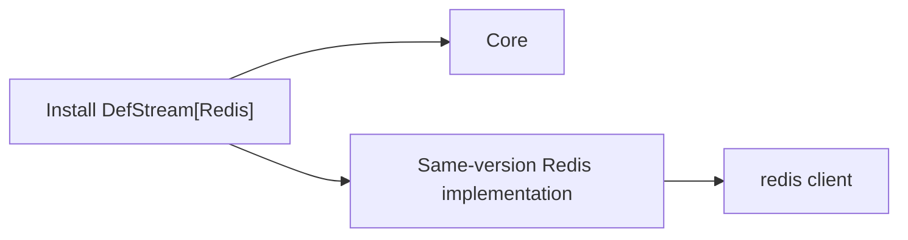

# Installation isolation, development and distribution

[한국어](./Packaging.md) · [Guide index](./README.en.md)

## Installed files

The `DefStream` core has no broker implementations. The `RabbitMQ` and `Redis` extras install the same-version `DefStream-RabbitMQ` and `DefStream-Redis` distributions and their external clients. Existing Python import paths remain unchanged.

In a new environment unselected implementation files and clients are absent. Omitting an extra later does not uninstall an existing implementation; explicitly remove its distribution when no longer needed.



## Migrate an existing environment

An integrated version or historical standalone adapter can own files at the same import paths. Prefer a new virtual environment. Otherwise remove all old distributions before selecting the extras you use:

```shell
python -m pip uninstall DefStream DefStream-RabbitMQ DefStream-Redis
python -m pip install "DefStream[RabbitMQ,Redis]"
python -m pip check
```

The new implementation distributions share the core's repository and version. To roll back, remove the new distributions first, then reinstall the explicit version previously used.

## Local editable development

Run from the repository root in a development virtual environment. No manually created junctions or symbolic links are needed. Every invocation refreshes metadata and links from the current local sources.

```shell
python -m pip install -e .
```

Omitting the option clears the previous selection and leaves only the core. Select implementations with `EXTRAS`; the commands are identical on Windows and POSIX shells:

```shell
python -m pip install -e . --config-settings EXTRAS=Redis
python -m pip install -e . --config-settings EXTRAS=RabbitMQ,Redis
```

Each command replaces, rather than accumulates, the selection. Names are case-insensitive; unknown names fail. Editable installs ignore a leftover `DEF_BUILD_TARGET`. They do not fetch remote source changes, force dependency upgrades, or uninstall external libraries removed from the selection.

When switching from an older split editable or regular installation, remove the old distributions once before reinstalling. The new editable core distribution owns all selected code and must not coexist with standalone implementation distributions:

```shell
python -m pip uninstall DefStream DefStream-RabbitMQ DefStream-Redis
python -m pip install -e . --config-settings EXTRAS=RabbitMQ,Redis
python -m pip check
```

Editable installs link only core and installed implementation files under the environment's `site-packages/__editable_defstream_view/` and expose that directory through a path-based `.pth`. IDEs can traverse the same tree without import hooks. Python checks installed metadata and link state at startup and updates the tree when necessary. Different environments sharing one source tree keep independent selections.

No separate core-first installation is needed. After adding files or changing package configuration, repeat the command with the desired `EXTRAS`. The managed link tree no longer depends on `build/`. Windows uses file symlinks when permitted and hard links otherwise; hard links require the sources and environment to be on the same volume.

Standard extras in `pip install -e ".[Redis]"` select external dependencies only. Use `--config-settings EXTRAS=Redis` to select implementation code. Regular `pip install "DefStream[Redis]"` still installs a separate implementation wheel.

Restart the language server after migration. No IDE-specific search paths or diagnostic suppression are needed. Regular wheels do not contain the link-management code. The local backend declared in `pyproject.toml` handles `EXTRAS` in editable hooks without invoking pip recursively or directly modifying the environment.

## Build and validate

One `src` and one `setup.py` serve every distribution. `DEF_BUILD_TARGET` accepts `core` (default), `RabbitMQ` and `Redis`; invalid values fail.

Build and validate from the repository root:

```shell
python -m pip install "pip>=23" build "setuptools>=77" "setuptools-scm>=8,<10" wheel twine
python scripts/build_distributions.py
python scripts/check_distributions.py --editable
python -m twine check --strict dist/*
```

The build script fixes the version, then creates each target's wheel and sdist in `dist/`. Do not mix other versions' artifacts. `--outdir` selects another destination; `--wheel` builds only wheels.

Each sdist includes `.distribution-target`, allowing `python -m build` to recreate the same distribution without an environment variable. Changing the sdist target is rejected.

Sdists contain the shared source tree. Unselected implementation files are excluded from built wheels and installed files; the source archives themselves are not split into isolated source trees.

CI checks build and installation isolation on supported Python versions. Releases verify names, versions and build numbers, then publish implementations before the core. PyPI publishing permissions and the token must cover all three names. Local builds do not publish anything.
