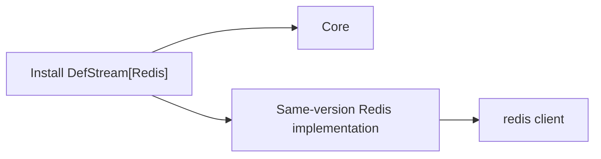

# Installation isolation, development and distribution

[한국어](./Packaging.md) · [Guide index](./README.en.md)

## Installed files

The `DefStream` core has no broker implementations. The `RabbitMQ` and `Redis` extras install the same-version `DefStream-RabbitMQ` and `DefStream-Redis` distributions and their external clients. Existing Python import paths remain unchanged.

In a new environment unselected implementation files and clients are absent. Omitting an extra later does not uninstall an existing implementation; explicitly remove its distribution when no longer needed.



## When you want to modify the source code

To fix or add features, use a development installation. An **editable installation** connects Python to your local source code so it can use that code directly.

Download the repository, activate a development virtual environment, and run the following command from the top-level folder containing `setup.py`. Here, `.` means the current folder and `-e` means an editable installation. You need pip 23 or later.

```shell
python -m pip install -e .
```

This connects only the common code. To also work on the RabbitMQ or Redis implementations, list their names in `EXTRAS`. The following commands are separate examples: the first selects Redis only, and the second selects both implementations.

```shell
python -m pip install -e . --config-settings EXTRAS=Redis
python -m pip install -e . --config-settings EXTRAS=RabbitMQ,Redis
```

Each run replaces the selection. For example, running with `EXTRAS=Redis` after selecting both implementations removes the RabbitMQ code from the development environment. Running without `EXTRAS` leaves only the common code. Names are case-insensitive; unknown names produce an error. Required external libraries are installed, but libraries for deselected implementations are not automatically removed.

### Try your changes

1. Edit the code under `src/`.
2. Start your application or tests again in the same virtual environment to check the result. Code in an already running program is not automatically reloaded.
3. If you add files or change the installation configuration, repeat the installation command with the desired `EXTRAS`.

The command connects the sources already on your computer. It does not fetch remote changes or force upgrades of external libraries. To select source code, use `--config-settings EXTRAS=Redis` as shown above, not `pip install -e ".[Redis]"`.

### How the development connection works

Only selected code is connected to the environment, and your IDE can find it too. Connections are managed automatically; you do not need to create links or add IDE search paths. Restart the language server if the IDE does not find the installed code right away. Multiple environments sharing the same sources keep their selections separate.

Refresh keeps unchanged file connections and atomically replaces each changed connection. It removes only deselected managed files and preserves other files such as `.DS_Store`. Switching all files simultaneously is not guaranteed.

On Windows, hard links are used if symbolic-link permissions are unavailable. In that case, keep the sources and virtual environment on the same drive. This connection management applies only to development installations, not regular wheel installations.

## Build and validate

Build and validate from the repository root:

```shell
python -m pip install "pip>=23" build "setuptools>=77" "setuptools-scm>=8,<10" wheel twine
python scripts/build_distributions.py
python scripts/check_distributions.py --editable
python -m twine check --strict dist/*
```

The build script fixes the version, then creates each target's wheel and sdist in `dist/`. Do not mix other versions' artifacts. `--outdir` selects another destination; `--wheel` builds only wheels.

Each sdist includes `.distribution-target`, allowing `python -m build` to recreate the same distribution without an environment variable. Changing the sdist target is rejected.

`TargetEggInfo.find_sources()` in `setup.py` maintains the additional build sources included in sdists. No separate `MANIFEST.in` is used. This source list does not install helper scripts into regular wheels.

Sdists contain the shared source tree. Unselected implementation files are excluded from built wheels and installed files; the source archives themselves are not split into isolated source trees.

CI checks build and installation isolation on supported Python versions. Releases verify names, versions and build numbers, then publish implementations before the core. PyPI publishing permissions and the token must cover all three names. Local builds do not publish anything.
