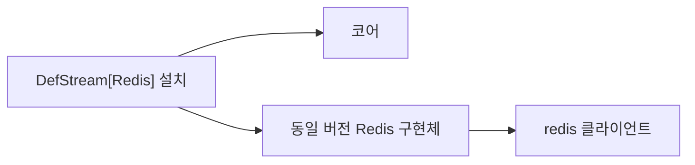

# 설치 격리와 개발·배포

[English](./Packaging.en.md) · [매뉴얼 목차](./README.md)

## 무엇이 설치되는가

`DefStream` 코어에는 브로커 구현체가 없습니다. `RabbitMQ`와 `Redis` extras는 각각 동일 버전 `DefStream-RabbitMQ`, `DefStream-Redis` 배포물과 외부 클라이언트를 설치합니다. 기존 Python import 경로는 유지합니다.

새 환경에서는 선택하지 않은 구현체 파일과 클라이언트가 설치되지 않습니다. 나중에 extra를 생략해도 이미 설치한 구현체는 제거되지 않으므로 필요 없다면 해당 구현체 배포물을 명시적으로 제거하세요.



## 소스 코드를 직접 수정하고 싶을 때

기능을 고치거나 추가하고 싶다면 개발용 설치를 사용하세요. 내려받은 소스 코드를 Python이 직접 사용하도록 연결하는 방식을 **editable 설치**라고 합니다.

저장소를 내려받고 개발용 가상환경을 활성화한 뒤, `setup.py`가 있는 저장소 최상위 폴더에서 실행하세요. 이 명령의 `.`은 현재 폴더, `-e`는 editable 설치를 뜻합니다. pip 23 이상이 필요합니다.

```shell
python -m pip install -e .
```

위 명령은 공통 코드만 연결합니다. RabbitMQ나 Redis 구현체도 수정하고 싶다면 `EXTRAS`에 함께 사용할 이름을 적으세요. 다음 두 명령은 각각 Redis만 선택하는 예시와 두 구현체를 모두 선택하는 예시입니다.

```shell
python -m pip install -e . --config-settings EXTRAS=Redis
python -m pip install -e . --config-settings EXTRAS=RabbitMQ,Redis
```

선택은 실행할 때마다 새 목록으로 바뀝니다. 예를 들어 두 구현체를 선택한 뒤 `EXTRAS=Redis`로 다시 실행하면 RabbitMQ 코드는 개발 환경에서 빠집니다. `EXTRAS` 없이 실행하면 공통 코드만 남습니다. 이름은 대소문자를 구분하지 않으며, 잘못된 이름은 오류로 알려줍니다. 선택한 구현체에 필요한 외부 라이브러리도 설치하지만, 선택에서 뺀 외부 라이브러리를 자동으로 삭제하지는 않습니다.

### 수정한 코드 확인하기

1. `src/` 아래의 코드를 수정합니다.
2. 같은 가상환경에서 애플리케이션이나 테스트를 새로 실행해 수정 결과를 확인합니다. 이미 실행 중인 프로그램의 코드는 자동으로 다시 로드되지 않습니다.
3. 파일을 새로 추가하거나 설치 구성을 바꿨다면 원하는 `EXTRAS`를 포함해 설치 명령을 다시 실행합니다.

이 명령은 컴퓨터에 있는 현재 소스를 연결할 뿐, 원격 저장소의 변경을 가져오거나 외부 라이브러리를 강제로 업그레이드하지 않습니다. 소스를 선택할 때는 `pip install -e ".[Redis]"` 대신 위의 `--config-settings EXTRAS=Redis`를 사용하세요.

### 개발 환경의 연결 방식과 주의사항

선택한 코드만 가상환경에 연결하므로 IDE에서도 해당 코드를 찾을 수 있습니다. 연결은 자동으로 관리되며 직접 링크를 만들거나 IDE 검색 경로를 추가할 필요가 없습니다. IDE가 설치 결과를 바로 찾지 못하면 Language Server를 재시작하세요. 같은 소스를 사용하는 가상환경이 여러 개여도 각 환경의 선택은 따로 유지됩니다.

갱신할 때는 바뀌지 않은 파일의 연결을 유지하고 바뀐 파일의 연결만 한 번에 교체합니다. 선택에서 빠진 관리 파일만 제거하고 `.DS_Store` 같은 다른 파일은 보존합니다. 다만 전체 파일을 동시에 전환하는 것은 보장하지 않습니다.

연결 중 오류가 발생하면 원인을 해결한 뒤 원하는 `EXTRAS`로 설치 명령을 다시 실행하세요. 도중에 추가된 파일도 다음 갱신에서 선택 목록에 맞게 정리합니다.

Windows에서는 심볼릭 링크 권한이 없으면 하드 링크를 사용합니다. 이 경우 소스와 가상환경을 같은 드라이브에 두세요. 이러한 연결 관리는 개발용 설치에만 적용되며 일반 wheel 설치에는 포함되지 않습니다.

## 빌드와 검증

저장소 루트에서 전체 배포물을 빌드·검사합니다.

```shell
python -m pip install "pip>=23" build "setuptools>=77" "setuptools-scm>=8,<10" wheel twine
python scripts/build_distributions.py
python scripts/check_distributions.py --editable
python -m twine check --strict dist/*
```

빌드 스크립트는 버전을 고정하고 대상별 wheel과 sdist를 `dist/`에 만듭니다. 다른 버전 산출물이 섞이지 않은 디렉터리를 사용하세요. `--outdir`로 다른 위치를, `--wheel`로 wheel 전용 빌드를 선택할 수 있습니다.

각 sdist에는 `.distribution-target`이 포함되어 별도 환경변수 없이 `python -m build`로 같은 배포물을 재생성합니다. sdist의 대상 변경은 거부합니다.

빌드에 필요한 보조 소스의 sdist 포함 목록은 `setup.py`의 `TargetEggInfo.find_sources()`에서 관리합니다. 별도의 `MANIFEST.in`은 사용하지 않으며, 이 목록은 일반 wheel에 보조 스크립트를 설치하는 설정이 아닙니다.

sdist는 공통 소스 트리를 포함합니다. 선택하지 않은 구현체의 파일을 제외하는 경계는 빌드된 wheel과 최종 설치 파일이며, sdist 원본 소스의 배포까지 분리하는 구조는 아닙니다.

CI는 지원 Python별 빌드·설치 격리를 검사하며, 릴리즈에서 이름·버전·빌드 번호를 확인하고 구현체를 먼저, 코어를 나중에 게시합니다. PyPI 게시 권한과 토큰은 세 배포 이름을 지원해야 합니다. 로컬 빌드만으로 게시하지는 않습니다.
