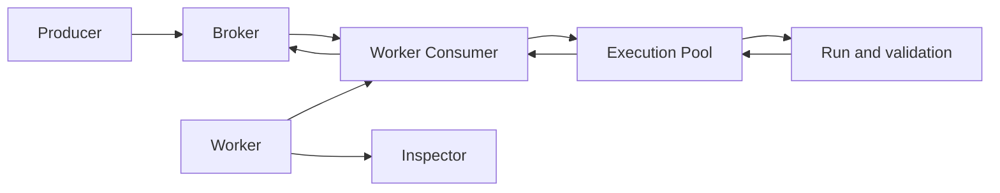

# DefStream Detailed Guide

[한국어](./README.md)

## What is DefStream?

DefStream is a synchronous task-processing library that runs Python methods for work delivered through a message broker. Instead of coroutine-based `async def` and `await`, define a task as a `Run` class and register it with a `Worker`. The Worker receives messages from the broker and executes tasks in a worker pool. Successful tasks are acknowledged (ACKed); failed tasks are redelivered or rejected according to the policy configured for the task.

Broker connections are provided through adapters, with support for RabbitMQ and Redis Streams. RabbitMQ supports queues, exchanges, and synchronous RPC; Redis Streams supports stream and consumer-group processing. Capabilities and settlement behavior differ by broker, so consult the corresponding broker guide for details.

In addition to task execution, DefStream provides thread and process pools for concurrency, per-task request and response validation, lifecycle hooks, and an Inspector for health checks and operations. This guide covers setup, task processing, broker-specific usage, and operational considerations. For the project overview and a minimal runnable example, see the [root README](../README.en.md).

## How message processing works

Messages published by a producer pass through the broker to a Worker Consumer, are processed in the execution pool, and are settled with a success ACK or failure policy. Inspector exposes Worker status and task contracts as a separate operational surface.

## Browse the guides

- [Installation and quick start](./GettingStarted.en.md): installation, broker prerequisites, and a first Worker
- [Task processing and execution](./Tasks.en.md): task APIs, delivery policies, and execution pools
- [Lifecycle hooks](./LifecycleHooks.en.md): hook order and resource management across Workers, pools, and tasks
- [Request/reply contracts and validation](./Contracts.en.md): schemas, validators, and task contracts
- [Operations and monitoring](./Operations.en.md): Inspector, logging, and operational broker considerations
- [RabbitMQ](./RabbitMQ.en.md): queues, exchanges, streams, RPC, and RabbitMQ workers
- [Redis Streams](./Redis.en.md): messages, consumer groups, acknowledgements, and Redis workers
