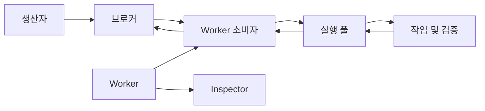

# DefStream 상세 매뉴얼

[English](./README.en.md)

## DefStream이란?

DefStream은 메시지 브로커에 등록된 작업을 Python 메서드로 처리하는 동기식 작업 처리 라이브러리입니다. 코루틴의 `async def`나 `await`를 사용하지 않고 `Run` 클래스로 작업을 정의하고 `Worker`에 등록하면, Worker가 브로커에서 메시지를 받아 실행 풀에서 처리합니다. 작업이 성공하면 메시지를 확인(ACK)하고, 실패하면 작업에 지정한 정책에 따라 재전달하거나 거부합니다.

브로커 연결 방식은 어댑터로 분리되어 있으며 RabbitMQ와 Redis Streams를 지원합니다. RabbitMQ에서는 큐와 Exchange, 동기 RPC를 사용할 수 있고, Redis Streams에서는 스트림과 소비자 그룹 기반 처리를 사용할 수 있습니다. 브로커별로 지원 기능과 정산 방식이 다르므로 세부 차이는 각 브로커 안내를 확인하세요.

DefStream은 작업 실행 외에도 동시 실행을 위한 스레드·프로세스 풀, 작업별 요청·응답 검증, 생명주기 훅, 상태 확인과 운영용 Inspector를 제공합니다. 이 문서는 이런 기능을 처음 구성하는 방법부터 브로커별 사용과 운영 고려사항까지 다룹니다. 프로젝트 소개와 최소 실행 예제는 [루트 README](../README.md)에서 확인할 수 있습니다.

## 기본 처리 구조

Producer가 발행한 메시지는 브로커를 거쳐 Worker의 Consumer로 전달되고, 실행 풀에서 처리된 뒤 성공 ACK 또는 실패 정책으로 정산됩니다. Inspector는 Worker의 상태와 작업 계약을 노출하는 별도 운영 표면입니다.

## 매뉴얼 찾아보기

- [설치와 빠른 시작](./GettingStarted.md): 설치 방식, 브로커 전제 조건, 첫 Worker 실행
- [작업 처리와 실행](./Tasks.md): 작업 API, 성공·실패 정책과 실행 풀
- [생명주기 훅](./LifecycleHooks.md): Worker·풀·작업 훅의 실행 순서와 자원 관리
- [요청·응답 계약과 검증](./Contracts.md): 스키마, validator와 작업 계약
- [운영과 모니터링](./Operations.md): Inspector, 로깅, 브로커 선택과 운영 고려사항
- [RabbitMQ](./RabbitMQ.md): 큐, Exchange, 스트림, RPC와 RabbitMQ Worker
- [Redis Streams](./Redis.md): 메시지, consumer group, ACK와 Redis Worker
