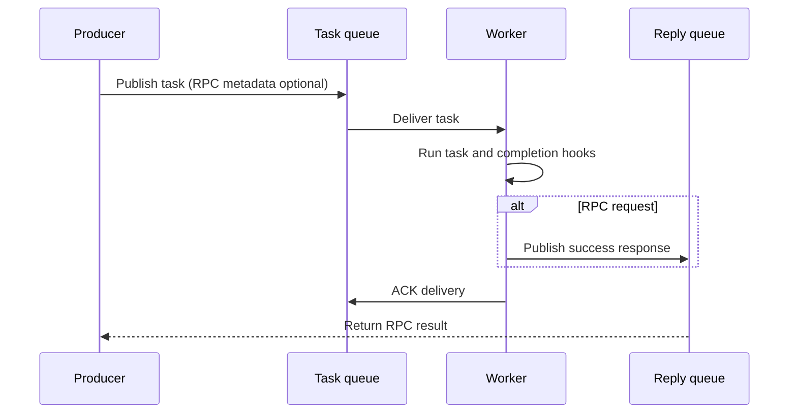

# RabbitMQ

[← Guide index](./README.en.md)

Connections, queues, exchanges, workers, and RPC.

## RabbitMQ usage

Requires Python 3.9 or newer and a reachable RabbitMQ server; uses Pika.

### Send and receive queue messages

This example uses a local RabbitMQ server's `guest` account. Use a dedicated
account and environment variables or a secret store in production.
It creates `defstream.example.rabbitmq` and leaves the queue in place.

```python
from DefStream.Broker.Implements.RabbitMQ import Configuration, Connection


connection = Connection(Configuration(
  host='127.0.0.1',
  port=5672,
  username='guest',
  password='guest',
))
try:
  connection.connect()
  connection.create_queue('defstream.example.rabbitmq')
  queue = connection.queue('defstream.example.rabbitmq')
  queue.send({'message': 'Hello, DefStream!'})
  event = queue.pop(timeout=1000)
  if event is not None:
    print(event.body)
    event.ack()
finally:
  connection.close()
```

The default codec serializes messages as JSON.
The `pop()` timeout is in **milliseconds**; a positive timeout returns `None`
if no delivery arrives. `None` or `0` waits indefinitely.
Call `ack()` on success, `nack()` for redelivery, or `reject()` to reject.
Rejected messages go to the broker-configured dead-letter destination or are
discarded when none is configured.

### Logging

`Connection`, `Consumer`, `Queue`, `Exchange`, `Stream`, and `Event` expose a class
member `logger` named `DefStream.Broker.Implements.RabbitMQ.ClassName`. Subclasses
inherit that logger unless they explicitly override it. The library adds no handlers
(including `NullHandler`), levels, or filters; propagation and `logging.lastResort`
keep their standard behavior.

Lifecycle and resource changes use INFO, per-message/RPC/settlement tracing uses DEBUG,
expected RPC anomalies use WARNING, and internal I/O or codec failures use ERROR.
Payloads, results, headers, credentials, exception text, and tracebacks are omitted.
Exceptions still propagate; application-side logging may duplicate a library record.
A publish return does not mean consumer processing completed, and an RPC response
timeout does not cancel delivered work.

The Python samples configure a root DEBUG console handler only in their main entry
points. Its filter accepts `Filter('Sample')` **or**
`Filter('DefStream.Broker.Implements.RabbitMQ')`, including dotted descendants only;
Pika and core logs are excluded. Applications configure their own handlers, levels,
and filters at a chosen ancestor (`DefStream`, `DefStream.Broker`, etc.) or class.

### Connection configuration

| Option | Meaning |
| --- | --- |
| `host`, `port` | RabbitMQ address and AMQP port |
| `username`, `password` | Credentials |
| `vhost` | Virtual host; defaults to `/` |
| `ssl` | Enable TLS; defaults to `False` |
| `timeout` | Blocked-connection timeout, in milliseconds |
| `heartbeat` | The current implementation passes `int(heartbeat * 2 / 1000)` seconds to Pika |
| `encode`, `decode` | Message codecs; JSON by default |

`timeout` is not a whole-operation deadline.
Configure and service connection heartbeats appropriately for task and idle periods.
Use connections and their resources **only on the owning thread**; do not
share them across threads or processes.

### Process tasks with a Worker

This executable example provisions a task queue and error queue, then consumes tasks.

```python
from signal import SIGINT, signal

from DefStream.Broker.Implements.RabbitMQ import (
  Configuration,
  Connection,
  Reject,
  Subscription,
)
from DefStream.Worker import Run, ThreadPool, Worker, WorkerSetup, declare


class Add(
  Run,
  parameters=Subscription(
    queue='defstream.example.rabbitmq.add',
    qos=4,
    error='defstream.example.rabbitmq.add.error',
  ),
  on_error=Reject(),
):
  def run(
    self,
    a: int,
    b: int,
  ):
    return a + b


class Prepare(WorkerSetup):
  def __call__(
    self,
    worker: Worker,
  ) -> None:
    for task in worker.tasks:
      declare(
        task=task,
        broker=worker.broker,
      )


if __name__ == '__main__':
  worker = Worker(
    Connection(Configuration(
      host='127.0.0.1',
      port=5672,
      username='guest',
      password='guest',
    )),
    ThreadPool(4),
    setups=Prepare(),
  )
  worker.add(Add)
  signal(
    SIGINT,
    lambda *_: worker.stop(),
  )
  worker.run()
```

Send `{'a': 10, 'b': 20}` to the same queue from another process.
The Worker ACKs after execution and completion hooks finish, and applies
the selected failure policy on error. Omitting `on_error` defaults to `Requeue()`.

`Subscription` options:

- `queue`: task queue name.
- `qos`: this subscription's unacknowledged-delivery limit. The consumer default
  is 1; 0 means unlimited. This is separate from shared Worker pool capacity.
- `error`: error queue to create and bind through `declare()`; a DLQ for rejected messages.
- `offset`: integer offset for RabbitMQ stream subscriptions.
- `max_priority`: maximum priority for a classic task queue; an integer in `1..255` or `None`.
- `priority`: default message priority; an integer in `0..max_priority` or `None`.
  Setting only this value sets `max_priority` to `255`.

Constructing a `Subscription` or calling `consumer.subs()` does not declare queues.
Task `declare()` provisions ordinary durable queues and an optional DLQ,
not stream queues or Exchange bindings. Incompatible existing queue options
fail explicitly; queues are not automatically deleted and recreated.

### Worker task priorities

Publish tasks with `DefStream.Worker.emit` or `connection.emit(body, parameters)`.
The task publication API is `emit`. Low-level `send()` and RPC `call()` on queues, exchanges,
and streams remain unchanged.

Set the default `priority` and queue `max_priority` together in the task's
`Subscription`. There is no separate `priority` setting on `Run`.

```python
class PriorityAdd(
  Add,
  parameters=Subscription(
    queue='defstream.example.rabbitmq.priority.add',
    qos=1,
    max_priority=5,
    priority=2,
  ),
):
  pass
```

- The Worker API `declare(task=PriorityAdd, broker=connection)` declares the queue
  with `x-max-priority=5` while preserving existing DLQ settings.
- `emit(..., task=PriorityAdd, broker=connection)` and
  `request(..., task=PriorityAdd, broker=connection)` use the task default of `2`.
  Pass `priority=0` or another valid value to override it for an individual call.
- Setting only the default sets the queue maximum to `255`. Setting only the
  maximum leaves the default as `None`. Without a per-call value either, the AMQP
  priority property is omitted.
- Worker calls validate against the task's effective maximum. If priority is
  specified only at call time, only the `0..255` range is validated; the caller
  must provision a priority queue beforehand.
- The existing low-level `Queue.send`, `Exchange.send`, and `Queue.call` also
  accept `priority=`. These APIs do not receive a task definition and therefore
  do not validate against a task-specific maximum. They accept integers in
  `0..255` and reject `bool`.
- Larger maximum values increase resource costs; configure only the levels you need.
- Task definitions declaring the same queue must use the same maximum.
  Redeclaring an ordinary queue or a queue with a different maximum propagates
  a RabbitMQ error. Queues are not automatically deleted. Switch to a new queue,
  or preserve pending messages before safely recreating the queue and migrating
  producers and consumers together.
- Higher values are delivered first, but prefetched messages and running tasks
  are not preempted. Redelivery and multiple consumers prevent guarantees about
  completion order, and lower-priority messages can wait indefinitely.
  Streams and quorum queues are outside the scope of this feature.

### Synchronous RPC

Call a queue served by a running Worker to receive the result of `Run.run()`.
Use the following between `connect()` and `close()` in the direct-connection example.

```python
result = connection.queue('defstream.example.rabbitmq.add').call(
  {'a': 10, 'b': 20},
  timeout=5,
)
print(result)
```

- `timeout` is in **seconds**. Missing replies raise `TimeoutError`.
  This does not cancel delivered work or strictly bound total connection and cleanup time.
- Each call owns a dedicated connection and temporary reply queue, cleaned up on exit.
- Server rejection raises `DefStream.Broker.RemoteError`.
  Requeue can retry without sending a final error response.
- Reply publication and request ACK are not atomic. Handle duplicate execution with RPC too.

Applications sharing a `Run` class can also use the core helper
`request(body, task=Add, broker=connection, timeout=5)`.



Reply publication and request ACK are not atomic. If a failure occurs after
publishing the reply but before ACK, the task may be redelivered and run again.

### Exchanges and streams

- `connection.exchange(name)` provides `send()` and `call()`.
  `event=` selects the routing key. Declare the Exchange, queues, and bindings first.
- Exchange RPC routed to several queues can execute at every destination and
  returns only the first matching reply. Use a single destination for ordinary RPC.
- Configure routing with `create_exchange()`, `bind_exchange_to_queue()`, and
  `bind_exchange_to_exchange()`. Corresponding `delete_...` or `unbind_...` methods are available.
- Use `create_stream()` to provision a stream queue, then access
  `connection.stream(name)` with `send()` and `read(offset=0, timeout=1000)`.
  The read timeout is in milliseconds.
  Read events are ACKed automatically when iteration advances.
- `delete_queue()`, `delete_stream()`, and `delete_exchange()` remove resources;
  use them only for resources owned by your application.

### Operational considerations

- Design idempotent tasks for at-least-once delivery.
- Unlimited requeue can repeatedly execute permanently invalid messages. Plan DLQ and retry policies.
- Execute long tasks in the Worker's pool rather than on the consumer connection.
- When publishing from task hooks, create a separate producer connection inside the hook's thread/process.
- `worker.stop()` waits for in-flight tasks and ACKs before closing the connection and pool.
  There is no forced termination or shutdown timeout.

### Samples

- [Sample.py](../samples/Broker/RabbitMQ/Sample.py)
- [Sample.Stream.py](../samples/Broker/RabbitMQ/Sample.Stream.py)
- [Sample.RPC.py](../samples/Broker/RabbitMQ/Sample.RPC.py)
