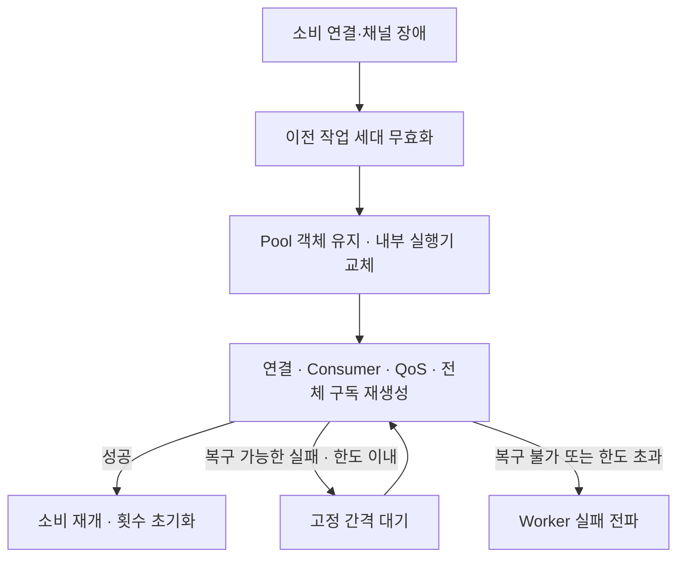
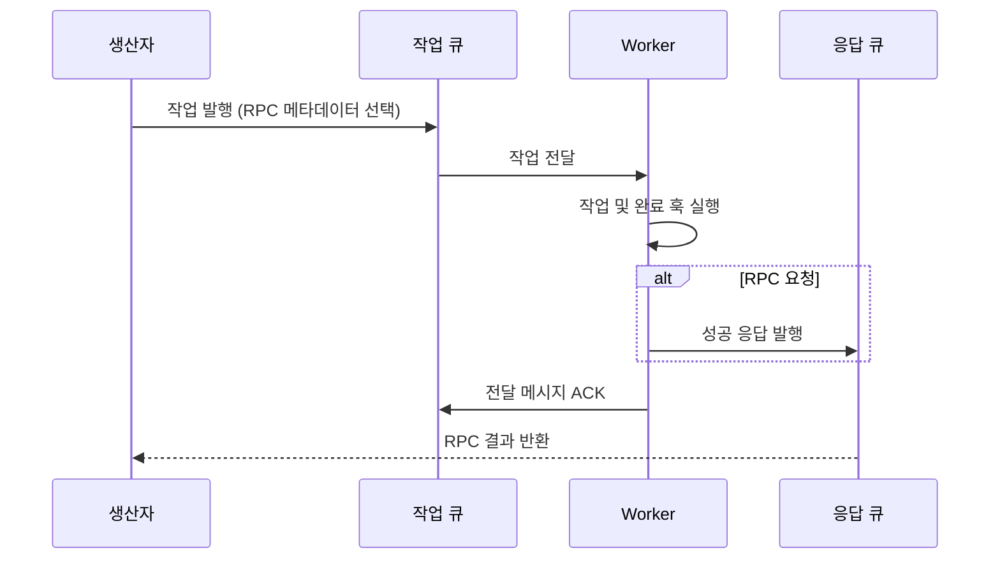

# RabbitMQ

[← 매뉴얼 목차](./README.md)

RabbitMQ 연결, 큐·Exchange, Worker와 RPC 사용법입니다.

## Worker 소비 장애 복구

Worker는 RabbitMQ 소비 연결·채널 장애 후 같은 프로세스 안에서 실행기와 연결을 복구합니다. 별도 supervisor는 필요하지 않습니다. 다음은 이미 구성한 `broker`와 DefStream `ThreadPool` 또는 `ProcessPool`인 `pool`을 사용하는 생성자 설정 발췌입니다.

```python
from DefStream.Worker import Worker


worker = Worker(
  broker,
  pool,
  recovery_attempts=5,
  recovery_interval=60,
)
```

- `recovery_attempts`: 장애 이후 복구 시도의 최대 횟수입니다. 기본값은 `5`이고, `0`이면 복구하지 않고 실패를 전파합니다. 음수가 아닌 정수만 허용하며 `bool`은 거부합니다.
- `recovery_interval`: 실패한 복구 시도 사이의 고정 대기 시간이며 단위는 초입니다. 기본값은 `60`입니다. 유한한 음수 아닌 `int`·`float`만 허용하며 `bool`은 거부합니다.
- 첫 복구는 즉시 시도합니다. 연결과 전체 구독 복원에 성공하면 다음 장애는 새 횟수 한도로 처리합니다. 대기 중 `stop()` 요청은 대기를 중단합니다. 연결이 잠시 복원됐다가 다시 끊기는 장애가 반복되면 장애마다 한도가 초기화되어 복구가 계속될 수 있습니다.
- 최초 Worker 시작 중 연결·구독 오류는 즉시 전파합니다. 복구 정책은 소비 루프가 시작된 뒤의 장애에 적용하며, 작업 코드 오류·정상 stop·독립적인 Queue/Exchange RPC 호출을 재시도하지 않습니다.



`StreamLostError` 등 연결 계층 장애와 연결·채널의 브로커 종료 코드 `320`·`541`, ACK timeout으로 인한 `406`, 명시적 stop 없는 소비 루프 종료를 복구 대상으로 처리합니다. 인증·접근 권한·프로토콜 불일치, 큐 부재와 일반적인 `PRECONDITION_FAILED` 등은 무조건 재시도하지 않습니다. ACK timeout 로그는 브로커 종료 사유와 영향받는 구독 큐 목록을 제공합니다. 공유 채널의 큐 목록만으로 어느 작업이 timeout을 유발했는지 단정할 수는 없습니다.

복구 시 사용자가 전달한 Pool 객체는 그대로 유지됩니다. ProcessPool의 이전 작업 프로세스는 강제 종료하며, 이때 작업·풀 cleanup 훅의 실행을 보장하지 않습니다. ThreadPool의 실행 중 작업은 강제 종료하지 않고 계속 실행되며, 이전 실행기에 종료를 요청하여 작업 완료 후 스레드를 정리합니다. 이전 미실행 작업은 폐기하고 이전 완료·실패 콜백은 새 정산·RPC 응답·상태에 영향을 주지 못하게 격리합니다. 사용자 지정 executor를 전달한 기본 `Pool`은 이 복구를 지원하지 않으며 명시적 오류가 발생합니다.

복구 중 이전 Consumer·연결을 정리하다 복구 가능한 연결 오류가 발생하면 로그를 남기고 새 연결 생성을 계속합니다. 복구 불가능한 정리 오류는 전파합니다. 종료 요청이 소비 시작 직전에 도착해도 새 소비를 시작하지 않습니다.

ProcessPool 실행 프로세스가 비정상 종료하면 정상 종료를 기다리는 도중에도 감지합니다. 남은 작업 프로세스를 종료·회수한 후 미완료 작업을 실패 처리합니다. 사용자 지정 executor는 복구 대상이 아니지만 소비 실패로 종료할 때 `shutdown(wait=False)`를 요청하여 원래 실패를 전파합니다. 이 요청이 사용자 지정 executor의 실행 중 작업을 강제로 중단한다는 뜻은 아닙니다.

닫힌 채널의 미확인 메시지는 브로커가 재전달할 수 있습니다. 이전 스레드와 재전달 작업의 중복 실행, 이미 발생한 DB 변경 등의 부작용은 제거되지 않으므로 처리의 멱등성은 사용자 책임입니다. 종료되지 않는 이전 스레드는 자원을 점유하고 Python 프로세스 종료도 지연시킬 수 있습니다. 한도 초과 시 Worker는 이전 작업 완료를 기다리지 않고 실패를 전파하지만 프로세스 강제 종료를 보장하지는 않습니다.

## RabbitMQ 사용 방법

Python 3.9 이상과 접속 가능한 RabbitMQ 서버가 필요하며 Pika를 사용합니다.

### 큐에 보내고 받기

로컬 RabbitMQ의 `guest` 계정을 사용하는 예제입니다.
운영에서는 별도 계정과 환경변수·비밀 저장소를 사용하세요.
예제는 `defstream.example.rabbitmq` 큐를 만들며 실행 후에도 큐를 유지합니다.

```python
from DefStream.Broker.Implements.RabbitMQ import Configuration, Connection


connection = Connection(Configuration(
  host='127.0.0.1',
  port=5672,
  username='guest',
  password='guest',
))
try:
  connection.connect()
  connection.create_queue('defstream.example.rabbitmq')
  queue = connection.queue('defstream.example.rabbitmq')
  queue.send({'message': 'Hello, DefStream!'})
  event = queue.pop(timeout=1000)
  if event is not None:
    print(event.body)
    event.ack()
finally:
  connection.close()
```

메시지는 기본 JSON 코덱으로 직렬화됩니다.
`pop()` 제한 시간은 **밀리초**이며, 양수 제한 시간에 메시지가 없으면 `None`을 반환합니다.
`None` 또는 `0`은 무기한 대기입니다.
처리가 성공하면 `ack()`, 재전달하려면 `nack()`, 거부하려면 `reject()`를 호출하세요.
거부한 메시지는 브로커의 dead-letter 설정이 있으면 해당 목적지로, 없으면 폐기됩니다.

### 연결 설정

| 옵션 | 의미 |
| --- | --- |
| `host`, `port` | RabbitMQ 주소와 AMQP 포트 |
| `username`, `password` | 인증 정보 |
| `vhost` | 가상 호스트, 기본값 `/` |
| `ssl` | TLS 사용 여부, 기본값 `False` |
| `timeout` | blocked-connection 제한 시간, 밀리초 |
| `heartbeat` | 현재 구현은 `int(heartbeat * 2 / 1000)`초로 변환하여 Pika에 전달 |
| `encode`, `decode` | 메시지 코덱, 기본값 JSON |

`timeout`은 모든 작업에 대한 전체 실행 제한 시간이 아닙니다.
일반 연결의 heartbeat는 애플리케이션 작업·유휴 시간에 맞게 설정하고 처리되도록 관리하세요.
연결과 그 리소스는 **소유 스레드에서만 사용**해야 하며, 스레드·프로세스 사이에 공유하지 마세요.

### 로깅

여섯 클래스는 `Broker.RabbitMQ.ClassName` 이름의 클래스 멤버
`logger`를 사용합니다(`Connection`, `Consumer`, `Queue`, `Exchange`, `Stream`, `Event`).
로거 이름은 모듈 경로(`DefStream.Broker.Implements.RabbitMQ`)와 다릅니다.
하위 클래스는 같은 로거를 상속하며 필요하면 멤버를 재정의할 수 있습니다.
라이브러리는 핸들러·`NullHandler`·레벨·필터를 설정하지 않고 루트로 전파합니다.
미설정 시 표준 `logging.lastResort` 동작을 유지합니다.
기존 `DefStream.Broker.RabbitMQ` 이름으로 필터나 핸들러를 설정했다면
`Broker.RabbitMQ`로 갱신하세요.

RabbitMQ 구현은 정상 동작을 INFO로 기록하지 않습니다.
연결 시도·성공·종료, 큐·Exchange·Stream 선언·삭제·바인딩 성공, Consumer의 구독 적용·채널 종료·소비 루프 생명주기,
메시지·RPC·정산 추적은 모두 DEBUG입니다.
작업마다 연결을 열고 닫아도 INFO 로그가 늘어나지 않습니다.
Worker 시작·준비·종료 같은 실행 생명주기는 `Worker` 로거의 INFO로 확인할 수 있습니다.
RPC 시간 초과·원격 오류·응답 라우팅 불가는 WARNING, 연결·자원 작업 실패를 포함한 내부 I/O·코덱 오류는 ERROR입니다.
본문·결과·헤더·인증정보와 예외 문자열·traceback은 기록하지 않으며 예외는 그대로 전파합니다.
애플리케이션이 같은 예외를 다시 기록하면 중복될 수 있습니다.
발행 API 반환은 소비자 처리 완료가 아니며, RPC 응답 시간 초과도 전달된 작업을 취소하지 않습니다.

`samples/Broker/RabbitMQ/*.py`는 실행 진입점에서만 루트 DEBUG 콘솔 출력을 구성합니다.
핸들러의 `Filter('Sample')` 또는 `Filter('Broker.RabbitMQ')`
통과 조건으로 두 이름과 점으로 구분된 하위 로거만 출력하며 Pika·코어 등은 제외합니다.
브로커 로거는 `DefStream` 계층 밖에 있으므로 다른 애플리케이션에서는 `Broker`,
`Broker.RabbitMQ` 또는 클래스 이름으로 선택하세요. `DefStream`은 Worker 등
코어 로거를 선택할 때 사용합니다.

### Worker로 작업 처리하기

다음은 큐와 오류 큐를 준비한 후 작업을 소비하는 실행 파일입니다.

```python
from signal import SIGINT, signal

from DefStream.Broker.Implements.RabbitMQ import (
  Configuration,
  Connection,
  Reject,
  Subscription,
)
from DefStream.Worker import Run, ThreadPool, Worker, WorkerSetup, declare


class Add(
  Run,
  parameters=Subscription(
    queue='defstream.example.rabbitmq.add',
    qos=4,
    error='defstream.example.rabbitmq.add.error',
  ),
  on_error=Reject(),
):
  def run(
    self,
    a: int,
    b: int,
  ):
    return a + b


class Prepare(WorkerSetup):
  def __call__(
    self,
    worker: Worker,
  ) -> None:
    for task in worker.tasks:
      declare(
        task=task,
        broker=worker.broker,
      )


if __name__ == '__main__':
  worker = Worker(
    Connection(Configuration(
      host='127.0.0.1',
      port=5672,
      username='guest',
      password='guest',
    )),
    ThreadPool(4),
    setups=Prepare(),
  )
  worker.add(Add)
  signal(
    SIGINT,
    lambda *_: worker.stop(),
  )
  worker.run()
```

다른 프로세스에서 같은 큐에 `{'a': 10, 'b': 20}`을 보내면 처리됩니다.
Worker는 실행과 완료 훅이 끝난 뒤 ACK하고, 실패하면 지정한 정책을 적용합니다.
`on_error`를 생략하면 기본값은 `Requeue()`입니다.

`Subscription` 옵션:

- `queue`: 작업 큐 이름.
- `qos`: 이 구독의 미확인 메시지 수 제한. 기본 소비자 값은 1이며, 0은 무제한입니다.
  Worker의 공유 풀 크기와 별개입니다.
- `error`: `declare()`가 생성하고 연결할 오류 큐 이름. 거부된 메시지의 DLQ입니다.
- `offset`: RabbitMQ 스트림 구독에 사용할 정수 오프셋.
- `max_priority`: classic 작업 큐의 최대 우선순위. 정수 `1..255` 또는 `None`.
- `priority`: 기본 메시지 우선순위. 정수 `0..max_priority` 또는 `None`.
  이 값만 지정하면 `max_priority`는 `255`로 설정됩니다.
- `timeout`: 큐별 ACK 대기 한도. 밀리초 단위의 양수 `int`, 양수의 정수 밀리초
  정밀도 `datetime.timedelta` 또는 `None`. 생략하면 브로커의 기존 설정을 따릅니다.

`Subscription` 객체 생성이나 `consumer.subs()`는 큐를 선언하지 않습니다.
작업용 `declare()`는 일반 durable 큐와 선택적 DLQ를 준비하며,
스트림 큐나 Exchange 바인딩을 자동 생성하지 않습니다.
선언 옵션이 호환되지 않아 발생한 오류는 전파하며 자동 삭제·재생성하지 않습니다.

### 장시간 작업의 ACK 대기 한도

RabbitMQ 3.12 이상에서 `Subscription.timeout`을 지정하면 작업용 `declare()`가
작업 큐에 `x-consumer-timeout`을 정수 밀리초로 전달합니다. 오류 큐에는 적용하지 않습니다.
앞의 Worker 예제에서 다음 작업을 정의하고 `worker.add(Add)` 대신
`worker.add(LongRunningAdd)`로 등록하면 기존 `Prepare`가 큐를 선언합니다.

```python
from datetime import timedelta


class LongRunningAdd(
  Add,
  parameters=Subscription(
    queue='defstream.example.rabbitmq.long.add',
    error='defstream.example.rabbitmq.long.add.error',
    timeout=timedelta(hours=24),
  ),
):
  pass
```

위 설정은 `x-consumer-timeout=86400000`을 전달합니다.
`timeout=86400000`처럼 정수 밀리초로 지정해도 같습니다.
`Subscription.timeout`은 생성 시 정수 밀리초로 정규화됩니다.
`Subscription.parse({'queue': 'tasks', 'timeout': timedelta(hours=24)})`처럼
Mapping으로도 지정할 수 있습니다. 생략 또는 `None`이면 해당 큐 인자를 보내지 않습니다.

- `bool` 및 `int`·`timedelta` 이외의 타입은 `TypeError`, 0·음수 또는 밀리초 미만 정밀도는
  `ValueError`로 거부합니다. 시간을 조용히 반올림하거나 절삭하지 않습니다.
- 객체 생성이나 구독만으로 설정을 적용하지 않습니다. 명시적인 작업 큐 선언이 필요합니다.
- 작업 실행을 강제 중단하는 기능이 아니며 완료 후 ACK·실패 정책·prefetch를 유지합니다.
  RPC 응답 대기시간은 별도입니다.
- 기존 큐의 설정 변경·재생성·policy 적용은 운영 측 책임입니다.

[RabbitMQ의 ACK timeout 안내](https://www.rabbitmq.com/docs/3.13/consumers#acknowledgement-timeout)에
따르면 1분 미만은 지원하지 않으며 5분 미만은 권장하지 않습니다.
이 검사는 약 1분 간격이므로 정확한 실행 제한 시간으로 사용하지 마세요.

### 워커 작업 우선순위

작업을 발행할 때는 `DefStream.Worker.emit` 또는
`connection.emit(body, parameters)`을 사용합니다. 기존 작업 발행 이름 `send`는
`emit`입니다.
큐·Exchange·Stream의 저수준 `send()`와 RPC `call()`은 변경하지 않습니다.

작업에 지정한 `Subscription`에 기본값 `priority`와 큐 최대값 `max_priority`를
함께 설정합니다. `Run`에는 별도의 `priority` 설정을 두지 않습니다.

```python
class PriorityAdd(
  Add,
  parameters=Subscription(
    queue='defstream.example.rabbitmq.priority.add',
    qos=1,
    max_priority=5,
    priority=2,
  ),
):
  pass
```

- 워커 API `declare(task=PriorityAdd, broker=connection)`는 큐에
  `x-max-priority=5`를 반영합니다. 기존 DLQ 설정도 보존합니다.
- `emit(..., task=PriorityAdd, broker=connection)` 및
  `request(..., task=PriorityAdd, broker=connection)`는 작업 기본값 `2`를 사용합니다.
  호출에 `priority=0` 또는 다른 유효한 값을 지정하여 재정의할 수 있습니다.
- 기본값만 정의하면 큐 최대값은 `255`, 최대값만 정의하면 기본값은 `None`입니다.
  호출별 값도 없으면 AMQP 우선순위 속성을 생략합니다.
- 워커 경로는 작업의 유효 최대값으로 검증합니다. 작업 설정 없이 호출에서만
  지정하면 `0..255` 범위만 검증하며, 우선순위 큐 사전 선언은 호출자 책임입니다.
- 기존 저수준 `Queue.send`, `Exchange.send`와 `Queue.call`도 `priority=`를 받습니다.
  이 경로는 작업 정의를 받지 않으므로 작업별 최대값은 검증하지 않습니다.
  정수 `0..255`만 허용하며 `bool`은 거부합니다.
- 최대값을 늘릴수록 자원 비용이 증가하므로 필요한 수준만 지정하는 것을 권장합니다.
- 동일 큐를 여러 작업 정의에서 선언한다면 최대값을 동일하게 맞춰야 합니다.
  기존 일반 큐나 최대값이 다른 큐를 재선언하면 RabbitMQ 오류가 전파됩니다.
  자동 삭제하지 않으므로, 새 큐로 전환하거나 미처리 메시지를 보존한 후 운영자가
  안전하게 재생성하고 생산자·소비자를 함께 전환해야 합니다.
- 높은 값이 먼저 전달되지만 이미 prefetch된 메시지나 실행 중인 작업은 선점하지
  않습니다. 재전달, 다중 소비자에서는 완료 순서를 보장하지 않으며 낮은 우선순위
  메시지가 오래 대기할 수 있습니다. Stream 및 Quorum 큐는 이번 지원 대상이 아닙니다.

### 동기 RPC

실행 중인 Worker가 있는 큐에 `call()`을 사용하면 `Run.run()`의 반환값을 받습니다.
아래 코드는 앞의 직접 연결 예제에서 `connect()`와 `close()` 사이에 사용하세요.

```python
result = connection.queue('defstream.example.rabbitmq.add').call(
  {'a': 10, 'b': 20},
  timeout=5,
)
print(result)
```

- `timeout`은 **초** 단위이며 응답이 없으면 `TimeoutError`가 발생합니다.
  이미 전달된 서버 작업을 취소하거나 전체 연결·정리 시간을 엄격히 제한하는 값은 아닙니다.
- 각 호출은 전용 연결과 임시 응답 큐를 사용하고 종료 시 정리합니다.
- 서버가 요청을 거부하면 `DefStream.Broker.RemoteError`가 발생합니다.
  재큐잉은 최종 오류 응답 없이 재시도할 수 있습니다.
- 응답 발행과 요청 ACK는 원자적이지 않습니다. RPC에서도 중복 실행에 대비하세요.

공유 `Run` 클래스를 사용하는 애플리케이션은 코어의
`request(body, task=Add, broker=connection, timeout=5)`도 사용할 수 있습니다.



응답 발행과 요청 ACK는 원자적이지 않습니다. 응답이 발행된 뒤 ACK 전에 실패하면 작업이 재전달되어 중복 실행될 수 있습니다.

### Exchange와 스트림

- `connection.exchange(name)`은 `send()`와 `call()`을 제공합니다.
  `event=`가 라우팅 키입니다. Exchange와 큐·바인딩을 먼저 선언하세요.
- Exchange RPC가 여러 큐로 라우팅되면 여러 곳에서 실행될 수 있으며,
  클라이언트는 첫 일치 응답만 받습니다. 일반 RPC에는 단일 목적지를 사용하세요.
- `create_exchange()`, `bind_exchange_to_queue()`, `bind_exchange_to_exchange()`로 라우팅을 구성합니다.
  각각에 대응하는 `delete_...` 또는 `unbind_...` 메서드도 있습니다.
- `create_stream()`으로 스트림 큐를 만든 뒤 `connection.stream(name)`의
  `send()`와 `read(offset=0, timeout=1000)`을 사용합니다. 읽기 제한 시간은 밀리초입니다.
  읽은 이벤트는 이터레이터가 다음 단계로 진행될 때 자동 ACK합니다.
- `delete_queue()`, `delete_stream()`, `delete_exchange()`는 리소스를 삭제하므로
  애플리케이션 소유 리소스에만 사용하세요.

### 운영 시 주의사항

- 최소 한 번(at-least-once) 전달을 전제로 멱등 작업을 작성하세요.
- 무제한 재큐잉은 영구 오류 메시지의 반복 실행을 만들 수 있습니다. DLQ와 재시도 정책을 설계하세요.
- 소비자 연결에서 긴 작업을 직접 실행하지 말고 Worker의 풀을 사용하세요.
- 작업 훅에서 발행하려면 훅이 실행되는 스레드·프로세스 안에 별도 생산자 연결을 만드세요.
- `worker.stop()`은 처리 중인 작업과 ACK를 기다린 뒤 연결과 풀을 닫습니다.
  강제 종료 또는 종료 대기 시간 제한은 제공하지 않습니다.

### 샘플

- [Sample.py](../samples/Broker/RabbitMQ/Sample.py)
- [Sample.Stream.py](../samples/Broker/RabbitMQ/Sample.Stream.py)
- [Sample.RPC.py](../samples/Broker/RabbitMQ/Sample.RPC.py)
