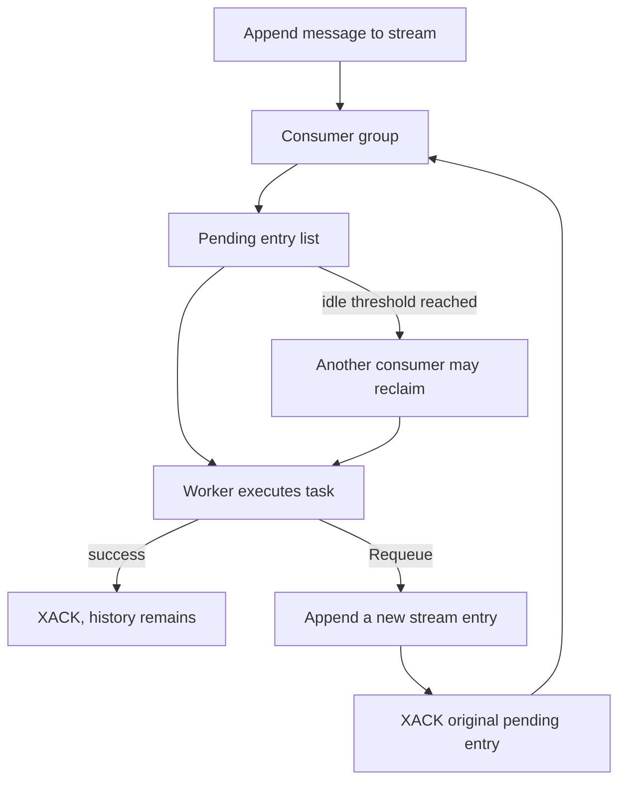

# Redis Streams

[← Guide index](./README.en.md)

Connections, consumer groups, workers, and acknowledgements.

## Redis usage

Requires Python 3.9 or newer and Redis 6.2 or newer. Uses redis-py Streams, not Pub/Sub or list-based queues.

### Send and receive messages

This example assumes a local Redis server at `127.0.0.1:6379`.
It creates the `defstream.example.redis` stream and `DefStream` group and leaves
them in place.

```python
from DefStream.Broker.Implements.Redis import Configuration, Connection


connection = Connection(Configuration(
  host='127.0.0.1',
  port=6379,
))
try:
  connection.connect()
  connection.create_queue(
    'defstream.example.redis',
    group='DefStream',
  )
  queue = connection.queue(
    'defstream.example.redis',
    group='DefStream',
  )
  message_id = queue.send({'message': 'Hello, DefStream!'})
  print(message_id)
  event = queue.pop(timeout=1000)
  if event is not None:
    print(event.id, event.body)
    event.ack()
finally:
  connection.close()
```

`connect()` verifies connectivity with PING and propagates failures.
The default codec stores the entire message as UTF-8 JSON in a single `body`
stream field. Legacy field-per-value streams are not compatible.
Set custom codecs through `Configuration(encode=..., decode=...)`.

### Connection configuration

| Option | Default and purpose |
| --- | --- |
| `host`, `port` | `127.0.0.1`, `6379` |
| `username`, `password` | Credentials; password-only authentication is supported |
| `secure` | Enable TLS; defaults to `False` |
| `database` | Database number; defaults to 0 |
| `type` | `ConnectionType.Pool` or `ConnectionType.Cluster` |
| `max` | Maximum connections; defaults to 10 |
| `timeout` | Connect/socket timeout in **seconds**; defaults to 5 |

Import `ConnectionType` from the adapter package.
The default Pool mode uses redis-py's connection pool.
Cluster mode uses Redis Cluster and requires `database=0`.
Read production credentials from environment variables or a secret store.

### Logging

`Connection`, `Consumer`, `Queue`, and `Event` each use a class-level logger named
`DefStream.Broker.Implements.Redis.<ClassName>`. Records propagate to the parent
`DefStream` logger and the root logger. The library does not configure handlers
or logging levels; configure output destinations and filters in your application.
Records exclude message bodies and credentials, and existing exceptions still
propagate to callers after an error is logged. Since callers may log the same
failure again, keep traceback logging at the boundary responsible for that failure.
The examples configure output only at their execution entry points, selecting
the `Sample` and Redis logger hierarchies at DEBUG level.

### Consumer groups and history

- `connection.queue(name, group='DefStream')` and `connection.stream(name, group='DefStream')`
  return the same stream-backed `Queue` type.
- `create_queue()` and `create_stream()` prepare the stream and group.
  Publishing/subscribing can also create the required resources lazily.
- New groups start at `0-0`, so messages published before subscription can be consumed.
- Consumers in the same group share messages; separate groups each receive them.
  Preserve the group name to continue an existing deployment's position and pending state.
- `pop(timeout=1000)` waits for one group delivery. Its timeout is in **milliseconds**.
  A positive timeout returns `None` when no delivery arrives; `None` or `0` waits indefinitely.

Read stream history without changing group state using this snippet between
`connect()` and `close()` in the direct-connection example:

```python
for event in connection.stream('defstream.example.redis').read(
  offset=0,
  timeout=1000,
):
  print(event.id, event.body)
```

`read()` reads existing history and new messages with a total millisecond timeout.
`None` or `0` tails indefinitely. Close the iterator to stop reading.
History events are not group deliveries and cannot be ACKed or requeued.
A string stream ID as `offset` resumes **after** that ID.

### Process tasks with a Worker

This executable example prepares a task stream and group, then consumes tasks.

```python
from signal import SIGINT, signal

from DefStream.Broker.Policies import Reject
from DefStream.Broker.Implements.Redis import Configuration, Connection, Subscription
from DefStream.Worker import Run, ThreadPool, Worker, WorkerSetup, declare


class Add(
  Run,
  parameters=Subscription(
    queue='defstream.example.redis.add',
    group='DefStream',
  ),
  on_error=Reject(),
):
  def run(
    self,
    a: int,
    b: int,
  ):
    print(a + b)


class Prepare(WorkerSetup):
  def __call__(
    self,
    worker: Worker,
  ) -> None:
    for task in worker.tasks:
      declare(
        task=task,
        broker=worker.broker,
      )


if __name__ == '__main__':
  worker = Worker(
    Connection(Configuration(
      host='127.0.0.1',
      port=6379,
    )),
    ThreadPool(4),
    setups=Prepare(),
  )
  worker.add(Add)
  signal(
    SIGINT,
    lambda *_: worker.stop(),
  )
  worker.run()
```

Send `{'a': 10, 'b': 20}` to the same stream from another process.
The Worker ACKs after execution and completion hooks finish; it does not return
the result as an RPC reply. The default failure policy is `Requeue()` if
`on_error` is omitted; this example selects `Reject()`.
You can also use the task API `emit(body, task=Add, broker=connection)`;
the caller must connect and close the connection.

The task helper and `connection.send(body, parameters)` have been renamed to `emit`.
Use `connection.emit(body, parameters)`.
Low-level `queue.send(body)` remains unchanged.

### ACK, rejection, and retries

| Operation | Effect |
| --- | --- |
| `ack()` | XACK for the group; preserves stream history |
| `reject()` / `Reject()` | XACK for the group; no built-in DLQ; preserves history |
| `nack()` / `Requeue()` | Append a new message and ACK the original pending entry |

Requeue uses an atomic single-key Lua script, but the copy has a new stream ID.
**The new message is visible to every group, not only the failing group.**
Use separate retry streams if retries need group isolation.
There is no automatic retry-count limit or built-in error stream.

Direct consumer users can configure:

| Option | Meaning |
| --- | --- |
| `connection.consumer(qos=1)` | Total local unacknowledged-delivery limit across subscriptions |
| `reclaim_idle=60000` | Idle milliseconds before pending-entry reclamation; defaults to 60 seconds |
| `reclaim_idle=None` | Disable automatic pending recovery |

The default Worker uses the default consumer settings.
Another consumer may reclaim a long task while it is still running; plan task
duration and recovery together. Shutdown leaves unfinished deliveries pending,
without ACK, for later recovery.

### Operational considerations



- Delivery is at least once. Make side effects safe to execute more than once.
- ACK/rejection preserves history; retries add entries. Manage retention externally
  and do not indiscriminately trim pending entries.
- `delete_queue()` and `delete_stream()` delete the stream key itself.
  Do not remove shared streams/groups in cleanup code without ownership.
- Connection, decoding, and handler failures propagate; there is no automatic reconnection.
- Exchanges and RPC are not supported. Do not use `request()` or console RPC.
- Redis Cluster is implemented, but current integration tests cover standalone Redis.
- The Worker's connection and pool belong to one run. `worker.stop()` waits for tasks and closes resources.

### Samples

- [Sample.py](../samples/Broker/Redis/Sample.py)
- [Sample.Stream.py](../samples/Broker/Redis/Sample.Stream.py)
