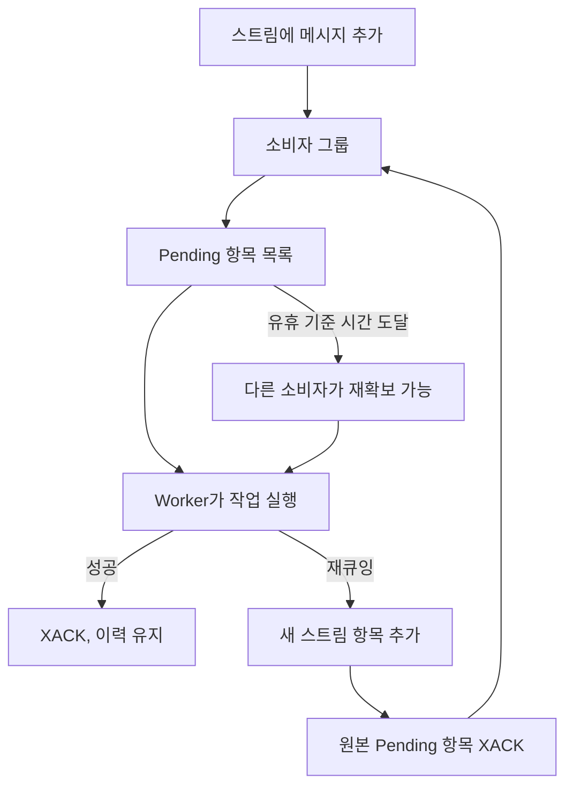

# Redis Streams

[← 매뉴얼 목차](./README.md)

Redis 연결, consumer group, Worker와 ACK 사용법입니다.

## Redis 사용 방법

Python 3.9 이상과 Redis 6.2 이상이 필요하며 redis-py의 Streams를 사용합니다. Pub/Sub이나 List 기반 큐가 아닙니다.

### 메시지 보내고 받기

로컬 Redis가 `127.0.0.1:6379`에서 실행 중이라고 가정합니다.
예제는 `defstream.example.redis` 스트림과 `DefStream` 그룹을 만들고 실행 후에도 유지합니다.

```python
from DefStream.Broker.Implements.Redis import Configuration, Connection


connection = Connection(Configuration(
  host='127.0.0.1',
  port=6379,
))
try:
  connection.connect()
  connection.create_queue(
    'defstream.example.redis',
    group='DefStream',
  )
  queue = connection.queue(
    'defstream.example.redis',
    group='DefStream',
  )
  message_id = queue.send({'message': 'Hello, DefStream!'})
  print(message_id)
  event = queue.pop(timeout=1000)
  if event is not None:
    print(event.id, event.body)
    event.ack()
finally:
  connection.close()
```

`connect()`는 PING으로 연결을 확인하며 오류를 숨기지 않습니다.
기본 코덱은 UTF-8 JSON이며 스트림의 `body` 필드에 메시지 전체를 저장합니다.
기존 field-per-value 방식 스트림과는 호환되지 않습니다.
사용자 정의 코덱은 `Configuration(encode=..., decode=...)`로 지정합니다.

### 연결 설정

| 옵션 | 기본값·의미 |
| --- | --- |
| `host`, `port` | `127.0.0.1`, `6379` |
| `username`, `password` | 인증 정보. 비밀번호만 사용하는 인증도 지원 |
| `secure` | TLS 사용 여부, 기본값 `False` |
| `database` | DB 번호, 기본값 0 |
| `type` | `ConnectionType.Pool` 또는 `ConnectionType.Cluster` |
| `max` | 최대 연결 수, 기본값 10 |
| `timeout` | 연결·소켓 제한 시간, **초** 단위, 기본값 5 |

`ConnectionType`은 어댑터 패키지에서 가져옵니다.
기본 Pool은 redis-py 연결 풀을 사용합니다.
Cluster는 Redis Cluster를 사용하며 `database=0`이어야 합니다.
운영 인증 정보는 환경변수·비밀 저장소에서 읽으세요.

### 로깅

`Connection`, `Consumer`, `Queue`, `Event`는 각각
`Broker.Redis.<클래스명>` 로거를 사용하며 상위 `Broker` 로거와 루트 로거로
전파합니다. 기존 `DefStream.Broker.Implements.Redis` 이름으로 설정한 필터나
핸들러는 `Broker.Redis`로 갱신하세요. 라이브러리는 핸들러나 로그 수준을
설정하지 않으므로 애플리케이션에서 필요한 출력 대상과 필터를 구성하세요.
기록에는 메시지 본문과 인증 정보가 포함되지 않으며, 오류 로그 후에도 기존
예외는 호출자에게 전파됩니다. 호출자가 같은 실패를 다시 기록할 수 있으므로
traceback은 담당 경계 한 곳에서만 남기세요. 예제는 실행 진입점에서만 `Sample`
및 `Broker.Redis` 로거 계층을 DEBUG로 출력하도록 설정합니다.

### 소비자 그룹과 이력

- `connection.queue(name, group='DefStream')`과 `connection.stream(name, group='DefStream')`은
  같은 스트림 기반 `Queue`를 반환합니다.
- `create_queue()`와 `create_stream()`은 스트림과 그룹을 준비합니다.
  발행·구독 시에도 필요한 리소스를 지연 생성할 수 있습니다.
- 새 그룹은 `0-0`부터 시작합니다. 구독 전에 발행된 메시지도 그룹에서 소비할 수 있습니다.
- 같은 그룹의 소비자는 메시지를 나눠 받고, 다른 그룹은 각각 메시지를 받습니다.
  기존 배포의 처리 위치와 pending 상태를 이어가려면 그룹 이름을 유지하세요.
- `pop(timeout=1000)`은 그룹 메시지 하나를 기다립니다. 제한 시간은 **밀리초**이며,
  양수 제한 시간에 메시지가 없으면 `None`을 반환합니다. `None` 또는 `0`은 무기한 대기입니다.

그룹 상태를 바꾸지 않고 스트림 이력을 읽을 수도 있습니다.
다음은 위 직접 연결 예제에서 `connect()`와 `close()` 사이에 사용하는 코드입니다.

```python
for event in connection.stream('defstream.example.redis').read(
  offset=0,
  timeout=1000,
):
  print(event.id, event.body)
```

`read()`는 기존 이력과 새 메시지를 읽으며 제한 시간은 총 밀리초입니다.
`None` 또는 `0`이면 계속 대기합니다. 읽기를 끝내려면 이터레이터를 닫으세요.
이력 이벤트는 그룹 처리용이 아니므로 ACK하거나 재큐잉하지 않습니다.
문자열 스트림 ID를 `offset`에 전달하면 해당 ID **이후**부터 읽습니다.

### Worker로 작업 처리하기

다음 실행 파일은 작업 스트림과 그룹을 준비한 뒤 소비합니다.

```python
from signal import SIGINT, signal

from DefStream.Broker.Implements.Redis import (
  Configuration,
  Connection,
  Reject,
  Subscription,
)
from DefStream.Worker import Run, ThreadPool, Worker, WorkerSetup, declare


class Add(
  Run,
  parameters=Subscription(
    queue='defstream.example.redis.add',
    group='DefStream',
  ),
  on_error=Reject(),
):
  def run(
    self,
    a: int,
    b: int,
  ):
    print(a + b)


class Prepare(WorkerSetup):
  def __call__(
    self,
    worker: Worker,
  ) -> None:
    for task in worker.tasks:
      declare(
        task=task,
        broker=worker.broker,
      )


if __name__ == '__main__':
  worker = Worker(
    Connection(Configuration(
      host='127.0.0.1',
      port=6379,
    )),
    ThreadPool(4),
    setups=Prepare(),
  )
  worker.add(Add)
  signal(
    SIGINT,
    lambda *_: worker.stop(),
  )
  worker.run()
```

다른 프로세스에서 같은 스트림에 `{'a': 10, 'b': 20}`을 보내면 처리됩니다.
Worker는 실행과 완료 훅이 끝난 뒤 ACK합니다. 반환값을 RPC 응답으로 보내지는 않습니다.
`on_error` 생략 시 기본값은 `Requeue()`이며 예제는 `Reject()`를 명시합니다.
Task API인 `emit(body, task=Add, broker=connection)`도 사용할 수 있고,
연결은 호출자가 열고 닫아야 합니다.

기존 작업 발행 함수와 `connection.send(body, parameters)`는 `emit`으로 이름이
바뀌었습니다. `connection.emit(body, parameters)`를
사용하세요. 저수준 `queue.send(body)`는 그대로입니다.

### ACK, 거부와 재시도

| 동작 | 효과 |
| --- | --- |
| `ack()` | 그룹에서 XACK. 스트림 이력은 유지 |
| `reject()` / `Reject()` | 그룹에서 XACK. 기본 DLQ 없음, 이력 유지 |
| `nack()` / `Requeue()` | 새 메시지를 추가하고 원래 pending 메시지를 ACK |

재큐잉은 단일 키 Lua 스크립트로 원자적으로 처리하지만, 복사본은 새 스트림 ID를 가집니다.
**새 메시지는 실패한 그룹뿐 아니라 다른 모든 그룹에도 보입니다.**
그룹별로 격리된 재시도가 필요하면 별도의 재시도 스트림을 설계하세요.
자동 재시도 횟수 제한이나 기본 오류 스트림은 제공하지 않습니다.

직접 소비자를 생성할 때 다음 설정을 사용할 수 있습니다.

| 옵션 | 의미 |
| --- | --- |
| `connection.consumer(qos=1)` | 모든 구독에 걸친 로컬 미확인 메시지 수 제한 |
| `reclaim_idle=60000` | 유휴 pending 항목을 재확보하기까지의 밀리초, 기본값 60초 |
| `reclaim_idle=None` | 자동 pending 복구 비활성화 |

기본 Worker는 기본 소비자 설정을 사용합니다.
긴 작업은 처리 중에도 다른 소비자가 재확보할 수 있으므로 작업 시간과 복구 정책을 함께 설계하세요.
종료 시 끝나지 않은 작업은 ACK하지 않고, 나중에 복구할 수 있도록 pending 상태로 남깁니다.

### 운영 시 주의사항



- 최소 한 번(at-least-once) 전달입니다. 부수 효과가 중복 실행되어도 안전하도록 설계하세요.
- ACK·거부 후에도 이력이 남고 재시도는 항목을 추가합니다. 보존 정책을 외부에서 관리하세요.
  처리 중인 pending 항목을 무분별하게 trim하지 마세요.
- `delete_queue()`와 `delete_stream()`은 스트림 키 자체를 삭제합니다.
  공유 스트림·그룹을 정리 코드에서 무단 삭제하지 마세요.
- 연결·디코딩·핸들러 오류는 호출자에게 전파하며 자동 재연결하지 않습니다.
- Exchange와 RPC는 지원하지 않습니다. `request()`와 콘솔 RPC를 사용할 수 없습니다.
- Redis Cluster 구성은 지원하지만 현재 통합 테스트 대상은 standalone Redis입니다.
- Worker의 연결과 풀은 한 번의 실행 전용입니다. `worker.stop()`은 작업을 기다린 뒤 자원을 닫습니다.

### 샘플

- [Sample.py](../samples/Broker/Redis/Sample.py)
- [Sample.Stream.py](../samples/Broker/Redis/Sample.Stream.py)
