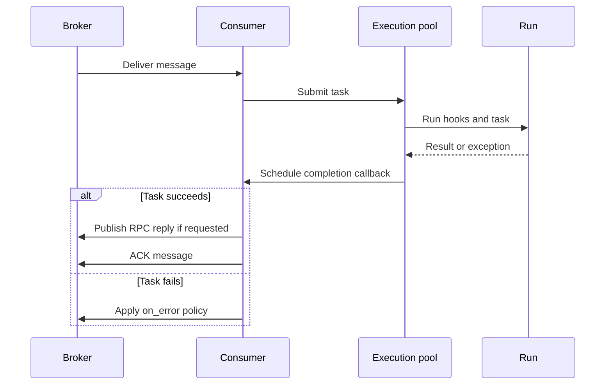

# Task processing and execution

[← Guide index](./README.en.md)

Task APIs, delivery policies, pools, and lifecycle hooks.

## Tasks and message handling

### Task-directed API

| Function | Purpose | Connection ownership |
| --- | --- | --- |
| `declare(task=..., broker=...)` | Declare task queues and subscription resources | Caller connects and closes |
| `emit(body, task=..., broker=...)` | Publish a one-way message to a task | Caller connects and closes |
| `request(body, task=..., broker=..., timeout=5)` | Request a task result synchronously | Caller connects and closes; RabbitMQ only |

Import these functions from `DefStream.Worker`. They do not connect or close
the supplied connection. Neither `emit()` nor `request()` declares destinations.
Call `declare()` in the receiving Worker's setup or a separate provisioning step.
Reuse a connection for multiple publications on its owning thread.

All three helpers accept the common `Connection` type and check declaration,
emission, or RPC support internally. Unsupported operations raise `NotImplementedError`.
The task helper and connection method previously named `send` are now named `emit`.
Custom brokers should use `Emittable.emit` instead of `TaskSender.send` for task emission.
Low-level `Sendable.send()` and RPC `Callable.call()` on queues, exchanges, and streams
remain unchanged.

Task bodies must be **mappings with string keys**. Return values must be
serializable by the adapter. A Worker cannot register multiple tasks for the
same queue: routing selects tasks by queue, not by a type field in the message.

Messages move from the consumer to the execution pool. When a result returns, the consumer's owning thread settles the message with an ACK or the configured failure policy. Publication and ACK are not one transaction, so account for possible duplicate execution.



### Task priorities

For RabbitMQ classic queues, define both the default message `priority` and queue
`max_priority` in the RabbitMQ `Subscription` supplied as the task's `parameters`.
There is no separate `priority` setting on `Run`.
`declare()` reads these settings to provision the priority queue.

```python
from DefStream.Broker.Implements.RabbitMQ import Subscription
from DefStream.Worker import (
  Run,
  declare,
  request,
  emit,
)


class Add(
  Run,
  parameters=Subscription(
    queue='defstream.example.priority.add',
    max_priority=5,
    priority=2,
  ),
):
  def run(
    self,
    a: int,
    b: int,
  ):
    return a + b


# broker is a RabbitMQ Connection connected by the caller.
declare(
  task=Add,
  broker=broker,
)
emit(
  {'a': 10, 'b': 20},
  task=Add,
  broker=broker,
)
# RPC requires a separately running Worker.
result = request(
  {'a': 10, 'b': 20},
  task=Add,
  broker=broker,
  priority=5,
)
```

- Omitting the call's `priority` or passing `None` uses the task default.
  An explicit `0` overrides the default with the lowest priority.
- Setting only the task default sets the queue maximum to RabbitMQ's limit of
  `255`. Setting only the maximum leaves the default as `None`; without a
  per-call value either, the message priority property is omitted.
- Values above the task maximum, negative values, non-integers, and `bool` are rejected.
- Specifying priority only at call time validates only the broker range `0..255`.
  The caller must provision a priority queue and respect its actual maximum.
- Child tasks inherit settings and may override them with valid values, but cannot
  clear them.
- Requesting priorities with Redis raises `NotImplementedError`.
  Calls without priorities retain existing Redis behavior.
- Priority affects delivery of waiting messages within the same queue. It does not
  preempt delivered or running tasks or guarantee execution and completion order.

### Success, failures, and retries

- ACK follows successful execution and completion hooks. RabbitMQ RPC also publishes the reply before ACK.
- Failures use the task's `on_error` policy. If omitted, the broker's default behavior applies; choose a policy provided by that broker, such as `Reject()`, when needed.
- `Policy` is the shared broker contract. Import `Requeue` and `Reject` from the selected broker package; behavior can differ by broker.
- Rejection is broker-specific: RabbitMQ dead-letters to a configured DLQ or discards the message;
  Redis acknowledges it for the group while preserving stream history.
- There is no automatic retry-count limit. Choose a policy that avoids endless redelivery of permanently invalid messages.
- Publication and ACK are not one transaction. **Make tasks idempotent and safe to execute more than once.**

The common resource operations below apply when accessing a broker directly.
Not every resource supports every operation.

Use `isinstance` or `issubclass` with `GetExchange`, `GetQueue`, `GetStream`,
or `GetConsumer` to check whether a connection provides `exchange()`, `queue()`,
`stream()`, or `consumer()`, respectively. Import these contracts from `DefStream.Broker`.

| Method | Purpose | Timeout unit |
| --- | --- | --- |
| `send(body)` | Publish a message | Adapter configuration |
| `call(body, timeout=5)` | Synchronous RPC | Seconds |
| `pop(timeout=1000)` | Receive one message | Milliseconds |
| `read(offset=0, timeout=1000)` | Read stream history and new messages | Milliseconds |

For `pop()` and `read()`, `None` or `0` waits indefinitely.
Settle directly consumed processing events with `ack()`, `nack()`, or `reject()`.
Redis history reads are separate from consumer-group processing and cannot be ACKed.
RabbitMQ stream reads are ACKed automatically when iteration advances.


## Execution pools and shutdown

| Pool | Typical use | Considerations |
| --- | --- | --- |
| `ThreadPool(4)` | I/O-bound tasks | Synchronize state shared across execution threads |
| `ProcessPool(4)` | CPU-bound tasks | Classes, inputs, results, and hooks must be picklable |

Import both pools from `DefStream.Worker`. Without an explicit size, they use
the CPU count. Capacity includes submitted, unfinished tasks; there is no
unbounded waiting queue. A full pool causes the Worker to NACK for redelivery.
RabbitMQ's per-task `Subscription.qos` limits unacknowledged deliveries, not pool size.

With `ProcessPool`, define classes and hooks at importable module scope and
create and run the Worker inside `if __name__ == '__main__':`.
Never pass broker connections or events to child processes.

`worker.stop()` stops receiving new work, waits for active tasks and message
settlement, then closes resources. There is currently no forced termination or
shutdown timeout. Register an application `SIGINT` handler as above for graceful
Ctrl+C shutdown. Each Worker, its connection, and its pool belong to a single
run: do not share them with another Worker or restart them.


See the dedicated [Lifecycle hooks guide](./LifecycleHooks.en.md) for hook interfaces, execution order, exception behavior, and resource-management examples.
