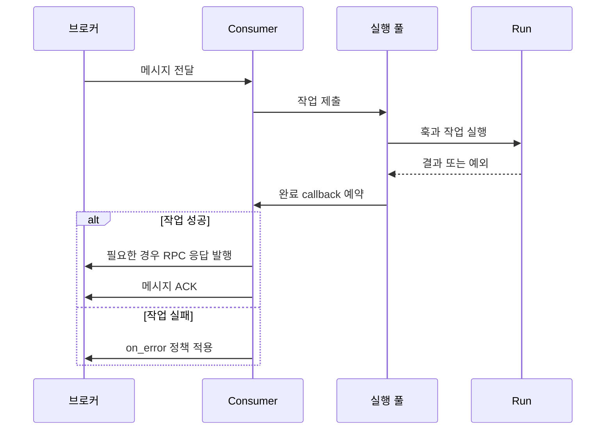

# 작업 처리와 실행

[← 매뉴얼 목차](./README.md)

작업 등록, 처리 정책, 실행 풀과 생명주기를 설명합니다.

## 작업과 메시지 처리

### 작업을 대상으로 하는 API

| 함수 | 역할 | 연결 관리 |
| --- | --- | --- |
| `declare(task=..., broker=...)` | 작업의 큐·구독 리소스 선언 | 호출자가 연결·종료 |
| `emit(body, task=..., broker=...)` | 작업 목적지로 단방향 메시지 발행 | 호출자가 연결·종료 |
| `request(body, task=..., broker=..., timeout=5)` | 작업 결과를 동기 RPC로 요청 | 호출자가 연결·종료; RabbitMQ만 지원 |

세 함수는 `DefStream.Worker`에서 가져옵니다. 전달된 연결을 자동으로 열거나 닫지 않으며,
`emit()`와 `request()`는 목적지를 자동 선언하지 않습니다.
수신 Worker 또는 별도의 준비 단계에서 먼저 `declare()`를 호출하세요.
하나의 연결을 같은 소유 스레드에서 여러 발행에 재사용할 수 있습니다.

세 함수 모두 공통 `Connection`을 받고, 내부에서 선언·발행·RPC 지원 여부를 확인합니다.
지원하지 않는 기능은 `NotImplementedError`로 실패합니다.
기존 작업 발행 함수와 연결의 `send`는 `emit`으로 이름이 바뀌었습니다.
사용자 정의 브로커의 작업 발행 계약도 `TaskSender.send` 대신 `Emittable.emit`을 사용하세요.
큐·Exchange·Stream의 저수준 `Sendable.send()`와 RPC `Callable.call()`은 그대로입니다.

작업 본문은 **문자열 키를 가진 매핑**이어야 하며, 반환값은 어댑터가 직렬화할 수 있어야 합니다.
하나의 Worker에서는 같은 큐에 여러 작업을 중복 등록할 수 없습니다.
메시지 유형을 보고 여러 `Run` 중 하나를 고르는 방식이 아니라 큐별로 작업을 선택합니다.

메시지는 소비자에서 실행 풀로 전달되고, 결과가 돌아오면 소비자 소유 스레드에서 ACK 또는 실패 정책으로 정산됩니다.
실패해도 전송과 ACK가 하나의 트랜잭션은 아니므로 중복 실행 가능성을 고려해야 합니다.



### 작업 우선순위

RabbitMQ classic 큐에서는 작업 `parameters`의 RabbitMQ `Subscription`에
`priority`로 기본 메시지 우선순위, `max_priority`로 큐 최대값을 함께 정의합니다.
`Run`에 별도의 `priority` 설정을 두지 않습니다.
`declare()`가 이 설정을 읽어 우선순위 큐를 준비합니다.

```python
from DefStream.Broker.Implements.RabbitMQ import Subscription
from DefStream.Worker import (
  Run,
  declare,
  request,
  emit,
)


class Add(
  Run,
  parameters=Subscription(
    queue='defstream.example.priority.add',
    max_priority=5,
    priority=2,
  ),
):
  def run(
    self,
    a: int,
    b: int,
  ):
    return a + b


# broker는 호출자가 연결한 RabbitMQ Connection입니다.
declare(
  task=Add,
  broker=broker,
)
emit(
  {'a': 10, 'b': 20},
  task=Add,
  broker=broker,
)
# RPC에는 별도로 실행 중인 Worker가 필요합니다.
result = request(
  {'a': 10, 'b': 20},
  task=Add,
  broker=broker,
  priority=5,
)
```

- 호출의 `priority`가 생략되거나 `None`이면 작업 기본값을 사용합니다.
  명시적 `0`은 가장 낮은 우선순위이며 기본값을 덮어씁니다.
- 작업 기본값만 지정하면 큐 최대값은 RabbitMQ 상한 `255`입니다.
  최대값만 지정하면 기본값은 `None`이며, 호출값도 없으면 메시지 속성을 생략합니다.
- 작업 최대값을 초과하는 값, 음수, 정수가 아닌 값과 `bool`은 거부합니다.
- 작업 설정 없이 호출에서만 지정하면 브로커 범위 `0..255`만 검증합니다.
  우선순위 큐의 사전 선언과 실제 큐 최대값 준수는 호출자 책임입니다.
- 자식 작업은 설정을 상속하고 유효한 값으로 재정의할 수 있지만 해제할 수는 없습니다.
- Redis에 우선순위를 요청하면 `NotImplementedError`가 발생합니다.
  우선순위 미지정 시 기존 Redis 동작은 유지합니다.
- 우선순위는 같은 큐의 대기 메시지 전달에 적용됩니다. 이미 전달·실행 중인
  작업을 선점하거나 여러 작업의 실행·완료 순서를 보장하지 않습니다.

### 성공, 실패와 재시도

- 작업 실행과 완료 훅이 성공한 뒤 ACK합니다. RabbitMQ RPC는 응답 발행도 ACK보다 먼저 수행합니다.
- 실패 시 `on_error` 정책을 적용합니다. 기본값은 `Requeue()`이며, `Reject()`를 명시할 수 있습니다.
- `Requeue`와 `Reject`는 공통으로 `DefStream.Broker.Policies`에서 가져올 수 있습니다.
- `Reject()`의 실제 효과는 브로커에 따라 다릅니다. RabbitMQ는 설정된 DLQ로 보내거나 폐기하며,
  Redis는 해당 그룹에서 ACK하고 스트림 이력은 유지합니다.
- 재시도 횟수의 자동 제한은 없습니다. 영구적인 오류가 무한 재전달되지 않도록 정책을 선택하세요.
- 전송과 ACK는 하나의 트랜잭션이 아닙니다. **중복 실행에 안전한 멱등 작업**을 작성해야 합니다.

브로커 리소스를 직접 사용할 때의 공통 메서드는 다음과 같습니다.
모든 리소스가 모든 메서드를 지원하는 것은 아닙니다.

연결의 `exchange()`·`queue()`·`stream()`·`consumer()` 지원 여부는 각각
`GetExchange`·`GetQueue`·`GetStream`·`GetConsumer`로 `isinstance` 또는 `issubclass`
검사할 수 있습니다. 이 계약들은 `DefStream.Broker`에서 가져옵니다.

| 메서드 | 의미 | 제한 시간 단위 |
| --- | --- | --- |
| `send(body)` | 메시지 발행 | 어댑터별 설정 |
| `call(body, timeout=5)` | 동기 RPC | 초 |
| `pop(timeout=1000)` | 한 메시지 수신 | 밀리초 |
| `read(offset=0, timeout=1000)` | 스트림 이력·새 메시지 읽기 | 밀리초 |

`pop()`과 `read()`에서 `None` 또는 `0`은 무기한 대기입니다.
직접 수신한 처리용 이벤트는 `ack()`, `nack()`, `reject()`로 정산하세요.
Redis 이력 읽기는 그룹 처리와 다르며 ACK 대상이 아닙니다.
RabbitMQ 스트림 읽기는 이터레이터가 다음 단계로 진행될 때 자동 ACK합니다.


## 실행 풀과 종료

| 풀 | 권장 용도 | 주의사항 |
| --- | --- | --- |
| `ThreadPool(4)` | I/O 대기 중심 작업 | 실행 스레드 사이에 공유하는 상태 보호 |
| `ProcessPool(4)` | CPU 연산 중심 작업 | 클래스·입력·결과·훅은 pickle 가능해야 함 |

두 풀은 `DefStream.Worker`에서 가져옵니다. 크기를 생략하면 CPU 수를 사용하며,
공유 풀의 용량은 제출되어 처리 중인 작업을 포함합니다. 무제한 대기열은 없습니다.
풀이 가득 차면 Worker는 메시지를 재전달하도록 NACK합니다.
RabbitMQ의 작업별 `Subscription.qos`는 미확인 메시지 수 제한이며 풀 크기와는 다릅니다.

`ProcessPool`을 사용할 때는 클래스와 훅을 import 가능한 모듈 최상위에 정의하고,
Worker 생성·실행을 `if __name__ == '__main__':` 안에 두세요.
브로커 연결이나 이벤트 객체를 자식 프로세스로 넘기지 마세요.

`worker.stop()`은 새 작업 수신을 멈추고 실행 중인 작업과 메시지 정산을 기다린 후 자원을 닫습니다.
현재 강제 종료나 종료 대기 시간 제한은 없습니다. 위 예제처럼 애플리케이션에서
`SIGINT`를 연결하면 Ctrl+C로 정상 종료할 수 있습니다.
Worker와 주입한 연결·풀은 한 번의 실행 전용이며 다른 Worker와 공유하거나 재시작하지 않습니다.


훅 인터페이스와 실행 순서, 예외 처리 및 자원 관리 예제는 [생명주기 훅 안내](./LifecycleHooks.md)를 참고하세요.
